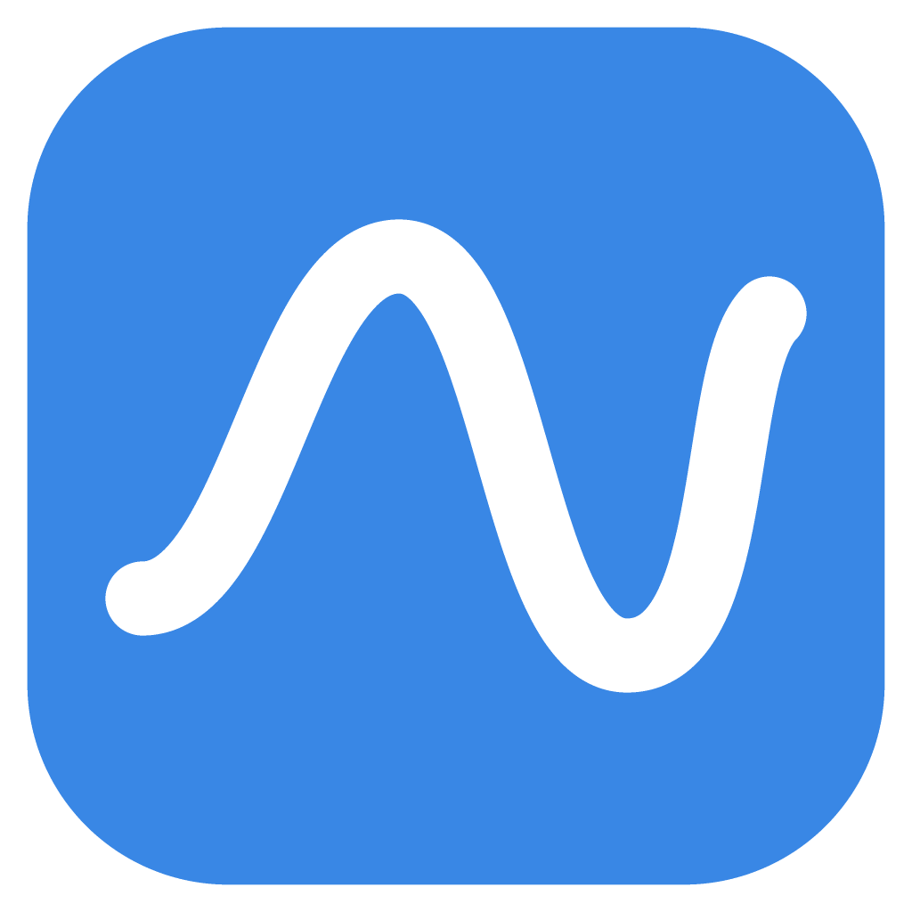
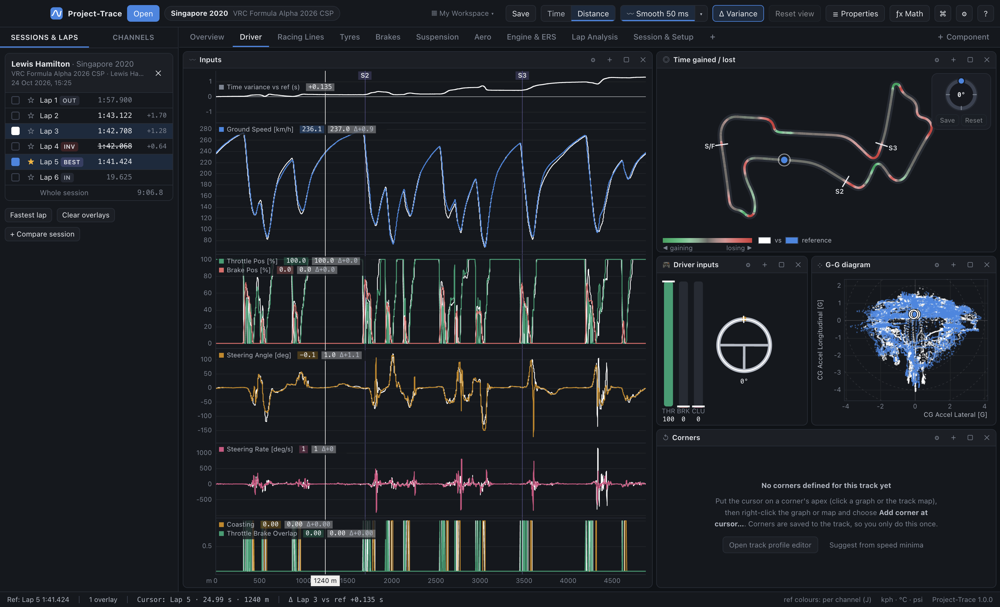
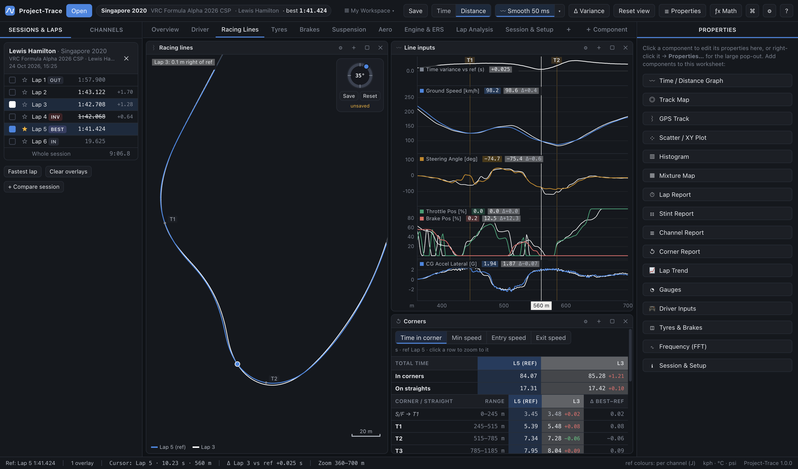
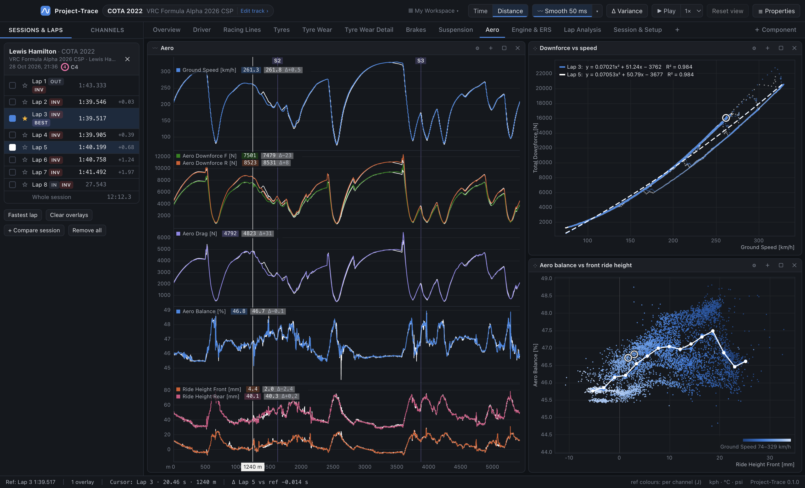
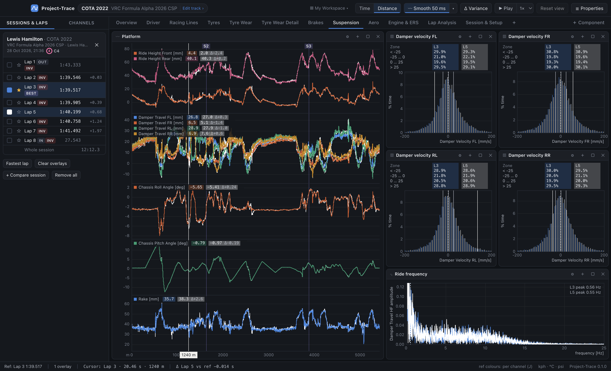
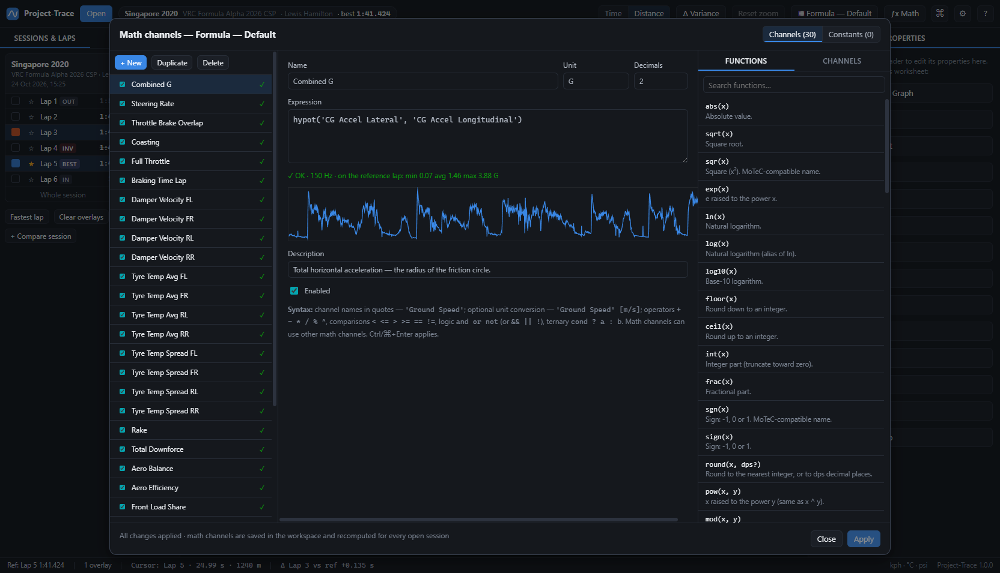
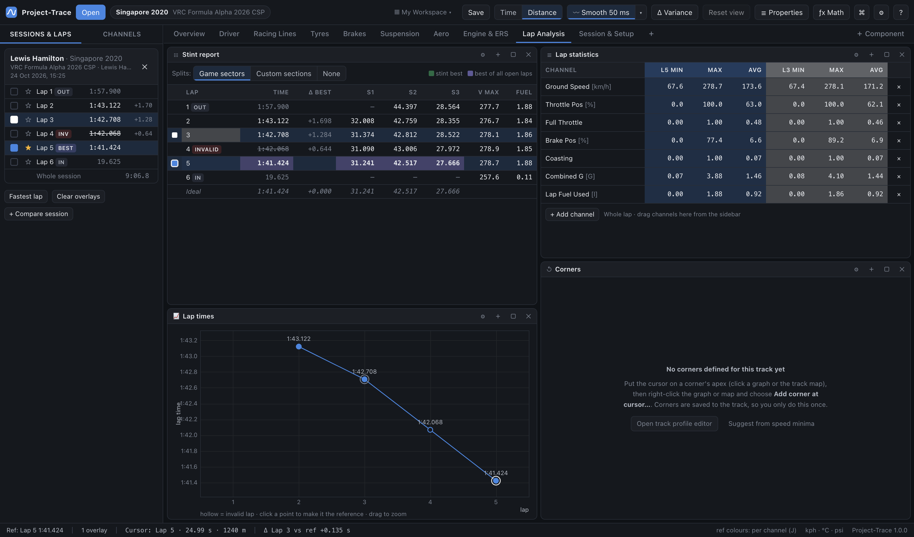
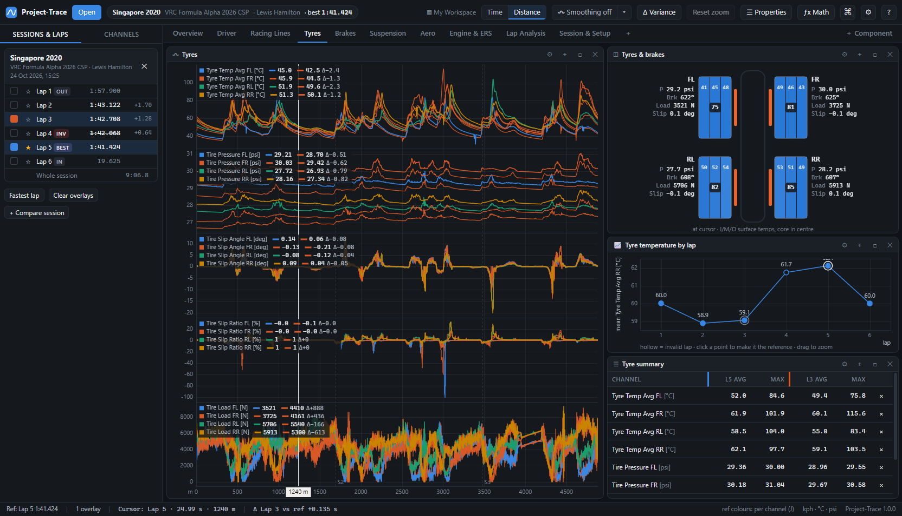
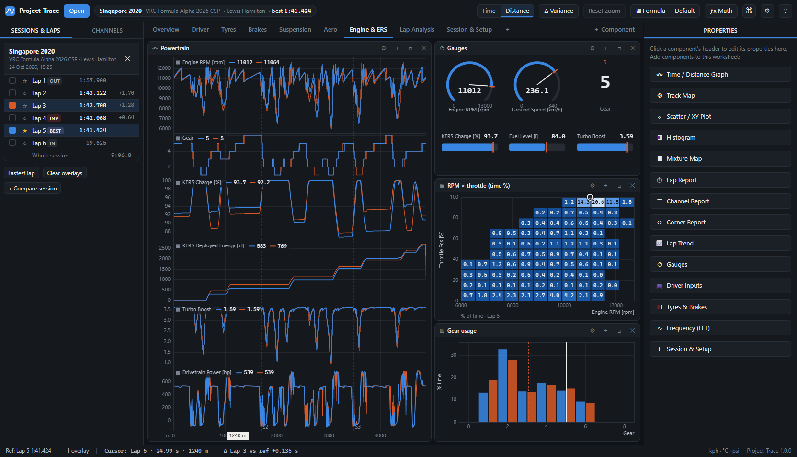

<p align="center"></p>

<h1 align="center">Project-Trace</h1>

<p align="center"><b>MoTeC-style telemetry analysis for Assetto Corsa, built for Telemetrick CSV exports (and MoTeC .ld logs).</b><br>
Runs on <b>Windows</b> and <b>macOS</b>. Free, offline, no account.</p>


Project-Trace is a desktop data-analysis tool modelled on MoTeC i2 Pro. Point it at your Telemetrick export folder, pick a track, pick a session, and you get MoTeC's core tools:

- time/distance graphs with lap overlays and time variance
- **bars** strips under the graphs: filled bars where a flag or condition (e.g. Brake Pos > 5) is true
- track maps and GPS racing-line comparison
- scatter plots, histograms and mixture maps
- math channels
- reports and gauges
- fully customisable workspaces with undo/redo

It reads the CSV files Telemetrick writes, and also opens Telemetrick's MoTeC `.ld` logs, so your whole history is usable, not just recent CSV exports.

---

## Make it a real app (Mac `.app` / Windows `.exe`)

Build a proper, double-clickable **Project-Trace** app with its own name and icon, to install yourself or share with others. You need **Node.js LTS** (<https://nodejs.org>) and this folder. Open a terminal in the folder and run `npm install` once.

**macOS** (build on a Mac):

```bash
npm run dist:mac
```

1. When it finishes (a minute or two), open the `release/` folder and double-click **`Project-Trace-<version>-arm64.dmg`**.
2. Drag **Project-Trace** into **Applications**.
3. From then on, open it like any other app — Launchpad, Spotlight or the Dock (right-click its Dock icon → *Options → Keep in Dock*). **No terminal needed.** Only build again when you want the latest changes, then drag the new app over the old one.

The app is ad-hoc signed (no paid Apple developer certificate), so a copy you build yourself opens straight away. Someone you **send** the `.dmg` to will be asked once: **right-click → Open → Open**, or **System Settings → Privacy & Security → Open Anyway**. It is built for your Mac's chip type (Apple silicon or Intel).

**Windows** (build on a Windows PC):

```bash
npm run dist:win
```

1. Open the `release\` folder and run **`Project-Trace Setup <version>.exe`** to install. The installer adds Start-menu and desktop shortcuts.
2. Or use the portable **`.zip`**: unzip it and run `Project-Trace.exe`, with no install needed.
3. If Windows shows *"Windows protected your PC"*, click **More info → Run anyway**. This appears because the app isn't code-signed.

**No Windows PC (or Mac)?** Push this repo to GitHub, open **Actions → Build installers → Run workflow**, and download both installers from the finished run's *Artifacts*. See [Building installers](#building-installers-exe--dmg).

Your settings, track profiles and workspaces are shared between the installed app and the `Start Project-Trace` launchers.

---

## Contents

- [Make it a real app](#make-it-a-real-app-mac-app--windows-exe)
- [Quick start](#quick-start)
- [What you can do](#what-you-can-do): a tour of every feature
- [Default workspaces](#default-workspaces)
- [Documentation](#documentation): detailed guides per feature
- [Building installers](#building-installers-exe--dmg)
- [Project layout](#project-layout)
- [Troubleshooting](#troubleshooting)

---

## Quick start

### 1. Install Node.js (one time)

Download the **LTS** version from <https://nodejs.org> and install it with the default options. This is the only prerequisite on both Windows and macOS.

### 2. Launch Project-Trace

| Windows | macOS |
|---|---|
| Double-click **`Start Project-Trace (Windows).bat`** | Double-click **`Start Project-Trace (macOS).command`**. The first time, *right-click → Open* to get past Gatekeeper. If macOS says it isn't executable, run `bash start-mac.sh` in Terminal from this folder. |

The first launch installs everything automatically (about a minute, needs internet). After that it starts in a few seconds. If you copy the folder between a PC and a Mac, the launcher notices that the installed components belong to the other system and reinstalls them.

> Developers can also use `npm install` then `npm start` (or `npm run dev` for hot reload).

### 3. Point it at your telemetry

On first launch the **Session Browser** opens. Click **Choose telemetry folder…** and pick any level of Telemetrick's export tree:

```
Documents\Assetto Corsa\apps\telemetrick\exported\           ← all drivers
    Lewis Hamilton\                                          ← one driver
        vrc_formula_alpha_2026_csp\                          ← one car  (recommended)
            singapore_2020-layout_f1_2026\                   ← tracks: the sessions live here
                24102026-152530-…-singapore_2020-layout_f1_2026.csv
```

Click a track card, then double-click a session to open it. Project-Trace remembers where you were, so next time you land straight on your track list.

No telemetry yet? Click **Bundled sample session** to explore a 6-lap Singapore run in the Formula Alpha 2026.

---

## What you can do

### Session browser: find the right run fast


- **Track cards** with tidied names (`singapore_2020-layout_f1_2026` → **Singapore 2020 · F1 2026**). **Sort them** by last driven, name, number of sessions or oldest first.
- **Session table** per track, showing:
  - when the file was **saved**;
  - the **in-game time of day**, converted to the circuit's local time zone;
  - driver, car and livery;
  - complete laps, **best lap** and **best valid lap**;
  - duration, air/track temperature and size.
- **Compare as many sessions as you like**: tick sessions across folders (your stints, another driver's), then **Add to open**. Selections survive browsing, double-click adds by default, and an *Open now* list shows what's loaded.
- A details pane with every lap time, plus **live folder watching**.

→ [Session browser guide](docs/02-session-browser.md)

### Time / distance graphs: the heart of MoTeC


- Stacked **panes** that share the x-axis. Drag the border between any two panes to give the important ones more height.
- **Lap colouring like MoTeC**: every overlay lap is solid in **its own lap colour**. The **reference lap** shows per-channel colours or its lap colour (press **J**). Right-click a lap's colour square to pick **any colour** for it (a click removes the lap).
- Every legend shows each lap's value **and its Δ to the reference** at the cursor.
- Three cursor modes (Settings): **classic** (click = cursor, drag = zoom), **scrub** (drag moves the cursor, double-click-drag zooms) or **follow mouse**. Shift-drag measures a range (min/avg/max/Δ). **W** zooms to the whole lap.
- **Time variance** pane (F3), **Time ⇄ Distance** axis (D), sector lines, and your own corner and section markers.
- **Smoothing** toggle in the top bar (on at 50 ms by default; off = raw data), with an adjustable amount.

→ [Graph guide](docs/04-time-distance-graph.md)

### Track Map and GPS Track
| Track Map: colour by speed, inputs or time gained/lost | GPS Track: compare the lines you drove |
|---|---|
|  |  |

- **Track Map**: colour the circuit by any channel, with preset or **custom colours**, by lap, or by **time gained/lost** against the reference.
- **GPS Track**:
  - thin racing lines for every selected lap in their lap colours;
  - automatically frames whatever you've zoomed into on the graphs, so zoom into a corner and compare the lines;
  - a metric scale bar and follow-cursor (raw car positions, no track edges);
  - live **"Lap 3: 0.8 m left of ref"** line-offset readouts.
- **Rotation dial** on both maps: drag the ring to spin the map, then **Save** it as the track's default or **Reset** to the saved rotation.
- **Corners are yours**: put the cursor on an apex, right-click → **Add corner at cursor…**. Corners are saved to the track and appear on graphs, maps and the corner report.

→ [Track Map & GPS Track guide](docs/05-track-map.md)

### XY charts
| Scatter (with fits) | Histograms & FFT |
|---|---|
|  |  |

- **Scatter / XY**:
  - colour by lap or a third channel;
  - linear, quadratic or cubic **fits with R²**;
  - X-interval averages and a gate channel;
  - **fixed X/Y axis ranges** in the Properties, and a G-G diagram mode.
- **Histograms** with zone breakdowns (damper velocities), **mixture maps**, **FFT** and **lap trend** (with a settable y-axis).
- **Drag a rectangle to zoom** on scatter, lap trend, histogram and FFT charts; double-click to reset.

→ [XY charts guide](docs/06-xy-charts.md)

### Math channels, just like MoTeC


- MoTeC-compatible syntax: `'Ground Speed' [m/s]`, `choose()`, `derivative()`, `integrate(x, cond)`, `smooth()`, `stat_mean()`… **60 functions** in all.
- Live validation with an error caret, a preview on the reference lap, and a click-to-insert function reference.
- **30 ready-made channels**: damper velocities, aero balance, coasting, lock-ups and more.

→ [Math channel guide](docs/07-math-channels.md)

### Laps, sectors & reports


- **Exact lap and sector times** matching the game.
- **Out, in, partial and invalid laps** flagged.
- **Lap report** (selected laps; sectors as times or **Δ to the reference**) and **stint report** (every lap of the selected stints, with the **ideal lap**). Bests fill the cell: green = stint best, purple = best of everything open.
- **Channel report** (min/max/avg/std per lap) and a **corner report** built from your corners — ranges found from your braking and throttle (adjustable with sliders), each corner tagged low / medium / high speed, plus the straights between them.
- **Lap playback** (▶ / Space, 0.25×–4×), **PDF printout** of any worksheet (Ctrl/⌘+P), **fuel-corrected lap times**, a **grip envelope** on the G-G diagram, and a **Corner Radius** channel.
- **Time breakdown**: time gained or lost against the reference in low, medium and high-speed corners and on the straights — the whole lap in four buckets. Side-by-side lap data is tinted in each lap's colour.

→ [Laps & reports guide](docs/08-laps-sectors-reports.md)

### Properties: everything in one pop-out


Edit any component in the docked **Properties side panel** (hidden at launch; toggle with Ctrl/⌘+I), or right-click it → **Properties…** (or **☰ Properties** in the top bar) for a large centred pop-out with a switcher for every component on the worksheet. Graphs list each pane's channels in detail (colour, unit, rate, range), and each channel has a **Properties…** button and a right-click menu for **renaming**, colour (palette or any custom colour), fixed range, decimals and unit. Renamed channels show your name everywhere while math and layouts keep using the logged name. Right-clicking any component also offers **Remove component** directly.

### Workspaces, worksheets, undo
- **Workspace** and **Worksheet** menus in the menu bar (next to File, Edit, Analysis):
  - switch workspaces, **Save** / **Save as** (Ctrl/⌘+S), create them from the Starter, duplicate, rename, export and import;
  - every workspace is a readable `.json` in **Documents/Project-Trace/Workspaces** — drop in someone else's to use their views;
  - **save worksheets to your library** and insert them anywhere, or export and import single worksheets;
  - **reset a worksheet** to its Starter version.
- **Undo / redo everything** (Ctrl/⌘+Z, Ctrl/⌘+Y): deleted components, panes, channels, worksheets, layout changes, corners, workspace deletions…
- Drag component headers to dock anywhere, drag gaps to resize, double-click to maximise. Everything saves automatically.

→ [Workspaces guide](docs/03-workspaces-and-layout.md)

### Instruments
| Tyres & brakes | Gauges, mixture map, histogram |
|---|---|
|  |  |

Four-corner tyre and brake panel, driver inputs (pedals, wheel, gear), dial/bar/digital gauges, and the full **car setup sheet** with side-by-side comparison and notes. → [Instruments guide](docs/09-instruments.md)

### Quality of life
- Command palette (Ctrl/⌘+K) and full [keyboard shortcuts](docs/10-keyboard-and-mouse.md) (J, W, S, C, D, F3, F…), all **rebindable** in the shortcut editor (F1).
- Units: km/h · mph · m/s, °C · °F, psi · bar · kPa. Dark and light themes.
- Export the visible range to CSV, save screenshots, drag & drop files.
- **Opens MoTeC `.ld` logs** as well as Telemetrick CSV, MoTeC CSV and generic CSV.

---

## Default workspaces

Project-Trace ships with two built-in, **read-only default workspaces**: the **Starter** (the layout you see on first launch, described below) and **Basic FA26**, a compact Formula Alpha 2026 layout (Overview, Driver, Toggles, PU, Tyres, Stint Analysis, Session & Setup). Your own workspace (**My Workspace**) starts as a copy of the Starter. If you edit a default, your change is saved into a new personal copy, so the defaults never change. To get the original back:

- **Workspace → Revert Current Workspace to Starter**, or **Worksheet → Reset Worksheet to Starter Version** for one tab;
- or simply switch to a default in the workspace menu (top bar or menu bar).

Your workspaces are files in **Documents/Project-Trace/Workspaces** — see [03 · Workspaces & layout](docs/03-workspaces-and-layout.md#the-workspaces-folder).

| Worksheet | What's on it |
|---|---|
| **Overview** | Speed, throttle/brake, gear, steering, RPM + variance · speed-coloured track map · lap times |
| **Driver** | Inputs, steering rate, coasting/overlap · gain/loss track map · driver inputs · G-G · corner report |
| **Racing Lines** | **GPS Track** · line-related channels (speed, steering, pedals, lateral G) · corner report |
| **Tyres** | Temperatures, pressures, slip, load · tyres & brakes panel · temperature trend · tyre summary |
| **Brakes** | Speed, brake, temps, lock-up/wheelspin · brake-pressure map · brake vs decel scatter |
| **Suspension** | Ride heights, damper travel, roll, pitch, rake · damper-velocity histograms · ride FFT |
| **Aero** | Downforce, drag, balance, ride heights · downforce-vs-speed fit · balance vs ride height |
| **Engine & ERS** | RPM, gear, KERS, boost, power · gauges · RPM × throttle map · gear usage |
| **Lap Analysis** | Stint report · lap-time trend · lap statistics · corner report |
| **Session & Setup** | Details / setup / notes · elevation map · fuel by lap |

---

## Documentation

| Guide | |
|---|---|
| [01 · Getting started](docs/01-getting-started.md) | Installation on Windows/macOS, first run, opening sessions |
| [02 · Session browser](docs/02-session-browser.md) | Folders, track sorting, the session table, in-game time zones |
| [03 · Workspaces & layout](docs/03-workspaces-and-layout.md) | Default workspaces, the workspaces folder, saving, menus, library, layout snapping, Properties pop-out, undo |
| [04 · Time/distance graph](docs/04-time-distance-graph.md) | Panes, lap colours, J, Δ legends, cursor, zoom, smoothing |
| [05 · Track Map & GPS Track](docs/05-track-map.md) | Colouring, line comparison, rotation dial, corners & sections |
| [06 · XY charts](docs/06-xy-charts.md) | Scatter (axis ranges), histogram, mixture map, FFT, lap trend |
| [07 · Math channels](docs/07-math-channels.md) | Syntax, every function, constants, the default library |
| [08 · Laps, sectors & reports](docs/08-laps-sectors-reports.md) | Lap detection, lap colours, sectors, lap & stint reports, corner report |
| [09 · Instruments](docs/09-instruments.md) | Gauges, driver inputs, tyres & brakes, session & setup |
| [10 · Keyboard & mouse](docs/10-keyboard-and-mouse.md) | Every shortcut and the shortcut editor |
| [11 · Supported file formats](docs/11-file-formats.md) | Telemetrick CSV, MoTeC .ld/.ldx, MoTeC CSV, generic CSV |
| [12 · Settings & data](docs/12-settings-and-data.md) | Units, themes, smoothing, where everything is stored |
| [13 · Architecture (developers)](docs/13-architecture.md) | Code structure, data flow, tests, adding components |

---

## Building installers (.exe / .dmg)

Running from source is all most people need. To produce a standalone app that doesn't need Node.js:

```bash
npm install
npm run dist:win    # on Windows → release/Project-Trace Setup 1.0.0.exe + portable .zip
npm run dist:mac    # on a Mac   → release/Project-Trace-1.0.0.dmg + .zip
```

macOS installers must be built on a Mac. The included GitHub Actions workflow (`.github/workflows/build.yml`) builds both: push the repo to GitHub, open **Actions → Build installers → Run workflow**, and download the installers from the run's artifacts. Builds are unsigned, so on macOS right-click → **Open** the first time.

---

## Project layout

```
Project-Trace/
├─ Start Project-Trace (Windows).bat   ← double-click launchers
├─ Start Project-Trace (macOS).command
├─ electron/          main process (window, files, native menus) + preload bridge
├─ src/
│  ├─ core/           parsers (CSV, .ld), session/lap model, math engine, corners, units, stats
│  ├─ state/          app store (incl. undo/redo), workspaces, layout tree, Starter workspace & math
│  ├─ charts/         every component (graphs, track map, GPS track, scatter, reports, instruments)
│  ├─ ui/             app shell: browser, sidebar, Properties pop-out, track editor, math editor
│  └─ workers/        background CSV/.ld parsing
├─ tests/             parser, math engine and .ld↔CSV cross-check tests
├─ sample-data/       a real Telemetrick export to try
├─ docs/              these guides + screenshots
└─ scripts/           launchers, install check, dev server, screenshot automation, icon
```

Useful commands: `npm test`, `npm run typecheck`, `npm run dev` (hot reload), and `npm run screenshots`. The last one captures every worksheet and runs end-to-end undo checks.

---

## Troubleshooting

| Problem | Fix |
|---|---|
| "Node.js is not installed" | Install the LTS version from nodejs.org, then run the launcher again. |
| macOS: "unidentified developer" | Right-click the `.command` file (or the app) → **Open** → **Open**. |
| macOS: launcher isn't executable / opens in a text editor | In Terminal: `cd` into the folder and run `bash start-mac.sh`. |
| Window doesn't appear when started from a VS Code terminal | Use `npm start` (not `electron .`); it clears VS Code's `ELECTRON_RUN_AS_NODE`. |
| I deleted something by accident | **Ctrl/⌘+Z** (Edit → Undo). For a whole tab: **Worksheet → Reset Worksheet to Starter Version**. |
| The in-game time looks off by some hours | Pick the right zone for that track in the Session Browser's details pane, or **Settings → In-game clock → Raw UTC**. |
| The track map is rotated or mirrored | Drag the dial ring, then **Save**; mirror in the Track editor (click the track name in the top bar) (both saved per track). |
| A math channel says "n/a" | The session doesn't contain one of its input channels (normal for non-AC data). |

---

*Project-Trace is an independent project and is not affiliated with MoTeC Pty Ltd, Kunos Simulazioni or the Telemetrick developers. "MoTeC" is used only to describe the style of analysis.*
