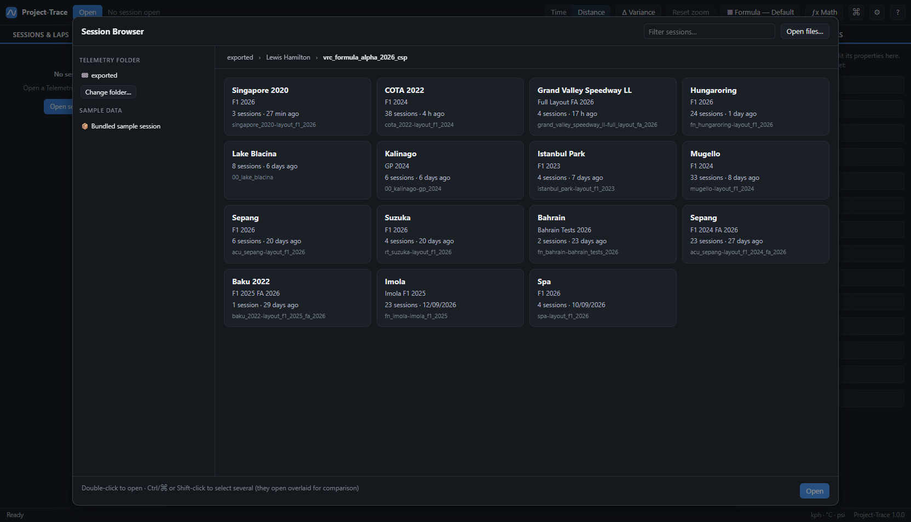
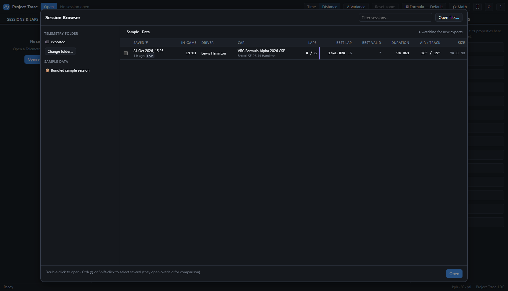

# 02 · Session browser

The Session Browser (**Open** button, **Ctrl/⌘ + O**) is how you find and open runs. It reads only the first ~96 KB of each file, so even folders with hundreds of 80 MB exports list instantly.

## Folder levels

Telemetrick saves exports as `exported/<Driver>/<car>/<track>/<files>`. Project-Trace shows:

- **Folder cards** for any sub-folders, most recently driven first. Track folders display a prettified name:
  - prefixes like `fn_`, `rt_`, `acu_`, `ks_`, `00_` are stripped;
  - the layout after the first `-` becomes the subtitle;
  - known acronyms (F1, GP, GT3, CSP…) are capitalised.
  So `fn_hungaroring-layout_f1_2026` reads **Hungaroring · F1 2026**. The raw folder name is shown underneath.
- Each card shows the **number of sessions** (an export that has both `.csv` and `.ld` counts once) and **when you last drove** there. The track you last opened is outlined.
- A **breadcrumb** trail lets you step back up to your telemetry folder.

Project-Trace remembers the last folder you opened a session from. Next launch it opens **one level above** (your track list) so you can pick a track straight away.

## The session table

| Column | Meaning |
|---|---|
| **Saved** | When the export was written (from the file header; falls back to the file name/date). Tag shows `csv` or `ld`. |
| **In-game** | The **time of day in the sim** at the start of the session (see below). |
| **Driver** | Driver name from the file. |
| **Car** | Car folder name prettified, plus the livery/team. |
| **Laps** | Complete laps / total laps (the first lap of a log is normally a partial out lap). |
| **Best lap** | Fastest complete lap from the header, with its lap number. The fastest in the folder is highlighted. |
| **Best valid** | Fastest lap that **wasn't invalidated**. AC's invalid flag is only known after reading the whole file, so this fills in once you've opened the session (it's cached). `?` = not opened yet. |
| **Duration** | Length of the log. |
| **Air / track** | Ambient and track temperatures at the start. |
| **Size** | File size. |

Click a column header to sort. Type in **Filter sessions…** to search by driver, car, track or file name.

### Selecting & opening
- **Double-click** a row to open it, replacing what's open.
- **Click** selects; **Ctrl/⌘ + click** adds to the selection; **Shift + click** selects a range.
- **Open** opens the selection; several sessions open together and their fastest laps are overlaid.
- **Add to current** keeps the open sessions and adds the new ones for comparison (also in the details pane as **Add to comparison**).

### Details pane
Selecting a row shows:
- track, layout, car and livery, driver;
- saved time, in-game time (local and UTC), duration;
- weather (sky, air and track temperature) and starting fuel;
- **every lap time** in the file, with the best highlighted;
- **Open**, **Add to comparison** and **Show file** buttons.

## In-game time of day

Telemetrick records CSP's sim clock as a **UTC timestamp** (`UTC Time` channel). CSP already applies the circuit's time zone, so to show the clock you'd see in game, Project-Trace converts it back into the **track's local zone**.

- Known circuits are recognised automatically: Singapore → *Asia/Singapore*, Suzuka → *Asia/Tokyo*, COTA → *America/Chicago*, Spa → *Europe/Brussels*, Hungaroring → *Europe/Budapest*, and ~40 more. Daylight saving follows the in-game date.
- For fictional or unrecognised tracks the time shows in UTC. Choose the right zone in the details pane (**In-game clock time zone for this track**). The choice is remembered per track.
- If you'd rather see the raw value, set **Settings → In-game clock → Raw UTC**.

> Example: the sample Singapore session's clock reads 11:01 UTC, displayed as **19:01** Singapore time, the night-race slot.

## Live updates

While a track folder is open, Project-Trace **watches it**. Save a new export from Telemetrick and it appears in the list a second or two later ("● watching for new exports").

## MoTeC `.ld` files

Telemetrick also writes a MoTeC `.ld` log (plus `.ldx` lap/setup sidecar) for every export, and older sessions may only exist in that format. Project-Trace lists and opens them too:
- in-game time comes from the first `UTC Time` sample;
- laps come from the `.ldx` beacons.

When a folder has both a `.csv` and an `.ld` for the same export, only one row is shown and the CSV is opened. See [11 · File formats](11-file-formats.md).

## Other ways in
- **Open files…** (top right) opens any CSV/`.ld` via the system file dialog.
- **Recent sessions** (left column) re-opens with one click.
- **Bundled sample session** opens the `sample-data/` folder.
- Drag files onto the main window at any time.
