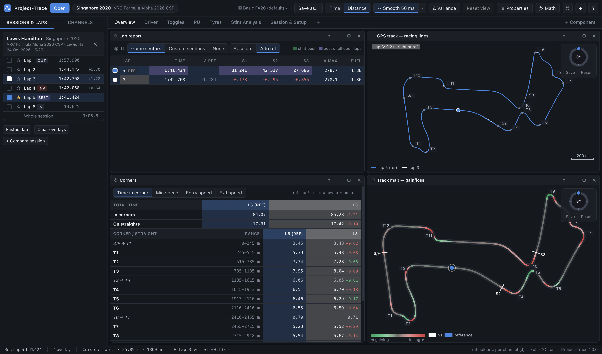
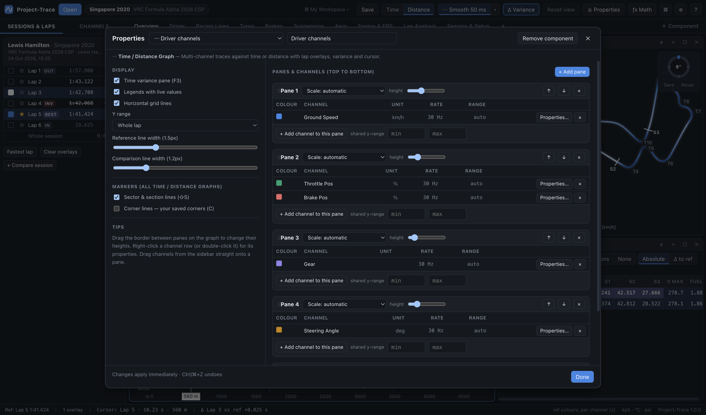
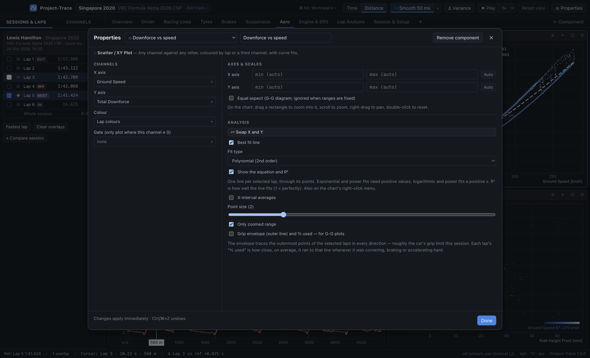

# 03 · Workspaces, worksheets & layout

Project-Trace follows MoTeC i2's organisation:

```
Workspace  ── e.g. "My Workspace"
 ├─ Worksheets (tabs) ── Overview · Driver · Racing Lines · …
 │   └─ Components laid out in resizable splits ── graphs, track maps, reports…
 ├─ Math channels + constants
 └─ Channel display properties (colours, fixed ranges, decimals, units)
```

Everything you change is **saved automatically**, and almost everything can be **undone**. There is also a **Save** button for peace of mind (see below).

## Default workspaces

Project-Trace ships with two **read-only default workspaces**:

| Default | What it is |
|---|---|
| **Starter** | The general layout: Overview, Driver, Racing Lines, Tyres, Brakes, Suspension, Aero, Engine & ERS, Lap Analysis, Session & Setup. |
| **Basic FA26** | A compact Formula Alpha 2026 layout: Overview (lap report, time breakdown, racing lines, corners, gain/loss map), Driver, Toggles, PU, Tyres, Stint Analysis, Session & Setup. |



- Defaults are rebuilt fresh on every launch, so they can never be lost or broken. They are marked *(default)* in the top bar.
- On first launch you get **My Workspace**, a copy of the Starter that is yours to change.
- If you edit a default, the change goes into a new personal workspace (e.g. *My Basic FA26*, with a short notice), and the default stays untouched. Or use **Save as…** to make your own copy first.
- To bring a workspace back to the original: **Workspace → Revert Current Workspace to Starter**. For one tab: **Worksheet → Reset Worksheet to Starter Version**, or right-click the tab → **Reset to Starter version**. Both can be undone.

## The workspaces folder

Every personal workspace is a plain `.json` file named after it, in one easy-to-find folder:

| OS | Workspaces folder |
|---|---|
| Windows | `Documents\Project-Trace\Workspaces\` |
| macOS | `~/Documents/Project-Trace/Workspaces/` |

Open it with **Workspace → Open Workspaces Folder**, the workspace menu in the top bar, or **Settings → Workspaces folder → Open**.

- **Using someone else's views**: drop their workspace `.json` into this folder. It appears straight away (a notice tells you) and is listed in the workspace menu. Files without an id or with a duplicate id are given their own automatically.
- **Sharing yours**: send the file from this folder (or use **Export Workspace…**).
- **Renaming** a workspace renames its file; **deleting** it removes the file.
- Workspaces from older versions (kept in the hidden settings folder) are copied here once, automatically. The originals are left where they were.

## The top bar

From left to right: the **track** (click to open the Track editor), the **workspace** menu (switch, save, folder, import / export), **Time / Distance**, **Smoothing**, **Δ Variance** (greyed out when the worksheet has no time / distance graph; highlighted while variance is showing), **▶ Play** with its speed, **Reset view** and **Properties**. Everything else is in the menu bar and the command palette: the session browser (Ctrl/⌘ + O), math channels (Ctrl/⌘ + M), command palette (Ctrl/⌘ + K), settings (Ctrl/⌘ + ,) and keyboard shortcuts (F1).

## Saving

Changes are saved automatically within a second. To save explicitly, or to make a copy:

| Action | Where | Keys |
|---|---|---|
| **Save** | the workspace name menu in the top bar, **Workspace → Save Workspace** | Ctrl/⌘ + S |
| **Save as…** | the workspace name menu, **Workspace → Save Workspace As…** (on a default, *Save* saves a copy) | |

A notice confirms the file it was saved to.

## Undo and redo

**Ctrl/⌘ + Z** undoes and **Ctrl/⌘ + Y** (or Ctrl/⌘ + Shift + Z) redoes. These are also in the **Edit** menu, and a short notice says what was undone. The history covers:

- adding, removing, moving, docking and resizing components;
- adding, deleting, renaming, duplicating, resetting and reordering worksheets;
- graph panes and channels: adding, removing, moving, pane heights and scales;
- component properties, channel properties and math channels;
- track profiles: corners, sections, saved rotation, mirror;
- creating, deleting, renaming and importing workspaces.

Continuous edits (like dragging a divider) become a single undo step. Inside a text box, Ctrl/⌘ + Z undoes your typing as usual. Viewing changes such as switching tabs, zooming or moving the cursor are not undo steps.

## Workspace menu

The workspace name in the top bar (**▦ name ▾**) opens a menu with the defaults, your workspaces, **Save**, **Save as…**, **Open workspaces folder**, **Import** and **Export**. The **Workspace** menu in the menu bar has the full list:

| Item | What it does |
|---|---|
| *workspace list* | Switch workspace (defaults are marked *built-in, read-only*). Math channels are recomputed. |
| **Save Workspace** / **Save Workspace As…** | See [Saving](#saving). |
| **Open Workspaces Folder** | Opens the folder in Finder / Explorer. |
| **New Workspace from Starter…** | A fresh copy of the Starter. |
| **New Blank Workspace…** | One sheet with a graph and a track map. |
| **Duplicate Current Workspace** | Copy to experiment safely. |
| **Rename Current Workspace…** | Also renames its file. |
| **Revert Current Workspace to Starter** | Replaces its worksheets and math with the Starter's (undoable). |
| **Export Workspace…** / **Import Workspace…** | Share a `.ptw.json` file anywhere on disk. Imports are added to your workspaces folder. |
| **Delete Current Workspace…** | Asks first; undoable. |

## Worksheet menu (menu bar)

| Item | What it does |
|---|---|
| **New / Duplicate / Rename / Delete Worksheet** | |
| **Reset Worksheet to Starter Version** | Restores the Starter layout of the tab with the same name. |
| **Save Worksheet to Library…** | Keeps a named copy in your personal worksheet library (shared by all workspaces). |
| **Insert Saved Worksheet ▸** | Adds a library worksheet as a new tab in the current workspace. |
| **Remove from Library ▸** | |
| **Export Worksheet…** / **Import Worksheet…** | Share one tab as a `.ptsheet.json` file. |

**Print to PDF**: **File → Print Worksheet to PDF…**, **Ctrl/⌘ + P**, or right-click the tab → *Print to PDF…* saves the worksheet on screen — exactly as shown, every component — as a one-page PDF titled with the worksheet, workspace, track, car, reference lap and date.

Tabs themselves:
- **click** a tab or press **1–9** to switch;
- **double-click** to rename;
- **drag** to reorder;
- **right-click** for Rename, Duplicate, Reset to Starter, Save to library, Export, Move, Delete;
- **＋** adds a tab.

## Components

There are 18 component types:

| Component | Purpose |
|---|---|
| Time / Distance Graph | Multi-channel traces with lap overlays, variance, cursor and zoom |
| Bars | Filled bars where a condition holds (a flag, or a channel =, >, <… a value), aligned with the graphs — see [04](04-time-distance-graph.md#bars) |
| Track Map | Track coloured by channel, lap or time gained/lost |
| GPS Track | Thin racing lines per lap for comparing lines |
| Scatter / XY Plot | Channel vs channel with fits, interval averages, axis ranges |
| Histogram | Distribution with zone breakdowns |
| Mixture Map | 2-D histogram (% time or a third channel) |
| Lap Report | Lap & sector/section times of the selected laps only; sectors as absolute times or Δ to the reference |
| Stint Report | Every lap of each stint that has a selected lap: lap & sector/section times, ideal lap |
| Channel Report | Min/max/avg/std per lap |
| Corner Report | Your corners (tagged low / medium / high speed) and the straights between them: time and speeds vs the reference, plus totals per bucket |
| Time Breakdown | Time gained / lost vs the reference in low, medium and high-speed corners and on straights |
| Lap Trend | A statistic per lap across the session |
| Gauges | Dial/bar/digital at the cursor |
| Driver Inputs | Pedals, wheel, gear, speed, RPM |
| Tyres & Brakes | Four-corner tyre and brake data — you choose which fields (temperatures, pressure, load, slip, wear…) |
| Frequency (FFT) | Spectrum of a channel |
| Session & Setup | Details, full setup sheet, notes |

### The window on macOS

There is no separate title bar: the red / yellow / green window buttons sit at the left of Project-Trace's own header. **Drag the header** (anywhere that isn't a button) to move the window, and **double-click** it to zoom. In full screen the buttons hide and the header uses the space.

### Adding, removing, arranging
- **＋ Component** (right end of the tab bar) adds to the current worksheet; **＋** on a header adds beside that component.
- **Right-click anywhere in a component** for a short menu: its main options (graphs and maps: marker lines, *Add corner* / *Add split* at the cursor), then **Copy**, **Paste beside**, **Duplicate**, **Properties…**, **Maximise** and **Remove component**. Everything else is in Properties.
- **Copy & paste**: click a component, then **Ctrl/⌘ + C** copies it with all its settings (channels, panes, colours, options); **Ctrl/⌘ + V** pastes a copy beside whichever component is selected — on another worksheet, in another workspace, or into an empty worksheet. **Ctrl/⌘ + D** duplicates in one go. All three are also in the right-click menu (*Copy*, *Paste beside*, *Duplicate*) and in *Edit* on the menu bar. In text boxes, or with text selected, the keys copy and paste text as normal.
- **Dock**: drag a component's **header** onto another component. Edges split; the centre swaps.
- **Resize**: drag the gaps between components. **Maximise**: double-click the header.
- **Snapping**: while you drag a divider it snaps (highlighted) to line up with other dividers running the same way — e.g. in a 2 × 2 grid the left and right columns' dividers, or the top and bottom rows' dividers, click into the same position. Hold **Alt/⌥** to move freely.

## The Properties pop-out



Properties are available in two forms that show the same settings:

- the **Properties side panel** on the right, hidden when the app starts and toggled with **Ctrl/⌘ + I** (or *View → Toggle Properties Panel*). It follows whichever component you click; drag its edge to resize it, and **⤢ Pop out** opens the large window;
- the **large centred pop-out**, opened by **right-clicking any component → Properties…** or the **☰ Properties** button in the top bar.

In the pop-out:
- the drop-down at the top switches to any other component on the worksheet;
- the title box renames the component;
- **Remove component** deletes it (undoable).

What's inside depends on the component:

| Component | Highlights |
|---|---|
| Graph | Display options (variance, legends, grid lines, line widths, marker lines for all graphs) plus a **panes & channels** section: each pane lists its channels with a **show / hide** toggle, **colour swatch**, unit, sample rate and range, a **Properties…** button and a right-click menu (colour, move to another pane, remove). Pane scale, height, order (drag a pane by its **⋮⋮** title, or ↑ / ↓) and shared y-range are here too. |
| Scatter | **Axes & scales**: fixed X and Y min/max (blank = automatic) and equal aspect, plus channels, colour, gate, **best fit line** (type and equation), interval averages. |
| Lap Trend | Statistic, lap-time mode and fuel effect, **best fit line** (type and equation), and **Y-axis min/max**. |
| Track Map | Colouring, including **custom low/high colours** and gain/loss **sensitivity** and **smoothing**, display options (zoom to the graphs' selection, outline, start/finish, car dots, legend), and a link to the **Track editor** (rotation, corners, splits). |
| GPS Track | Line width, framing, follow-cursor, scale bar, legend, offset readout, plus a link to the Track editor. |
| Corner Report / Time Breakdown | Metric, straights and totals, or bars; plus a link to the Track editor (corners, ranges, speed buckets). |
| Bars | Rows (channel, condition, value(s), label, colour, order / priority), combine all rows into one, every lap or the reference only, row labels, x-axis labels, marker lines. |
| Lap / Stint Report | Split columns, Δ column, ideal row, tags, max speed & fuel. |
| Tyres & Brakes | Values (cursor / lap mean / lap max) and which of 20 fields each tyre shows. |
| Driver Inputs | Compare lap, and which parts to show (pedals, clutch, wheel, gear, speed, RPM). |

## Channel properties



Open from the Channels sidebar or the graph Properties' channel table:
- **Display name**: rename the channel (e.g. *Tire Temp Core FL* → *Core FL*). See [Renaming channels](#renaming-channels).
- **Colour**: palette swatches, a **Custom…** colour picker or a hex value, or *Auto*. This colour is used by the reference lap when it shows channel colours (see [04](04-time-distance-graph.md#lap-colours)).
- **Fixed min / max** (display units), **decimal places**, **display unit override**.

Stored per workspace.

## Renaming channels

Give any channel a name of your own:

- right-click it in the **Channels** sidebar → **Rename…**;
- right-click its row in a graph's Properties channel table → **Rename…**;
- or type a **Display name** in **Channel properties**.

The new name appears everywhere: graph legends, axis titles, track-map and histogram legends, reports, gauges, component titles, the channel picker and the sidebar (searching finds either name). Leave the name empty to go back to the logged name.

It's a **display name**: underneath, the channel keeps its logged name, so graphs, math channels (which refer to channels by their logged name), CSV exports and saved layouts all keep working — nothing has to be updated. (Renaming a *math channel* in the math editor changes its real name instead, and every graph, component and expression that used it is updated automatically — see [07](07-math-channels.md#renaming-a-math-channel).) Hovering a renamed channel shows *logged as …*. Names are stored with the workspace's channel properties, so they travel with an exported or shared workspace.

## The sidebar

The left sidebar (toggle with **Ctrl/⌘ + B**; drag its edge to resize) has two tabs:

- **Sessions & laps**: each session's laps. Click a selected lap's colour square to remove it; right-click it to change its colour. **Reorder sessions** by dragging a session's header onto another session (a blue line shows where it will go), or right-click the header → *Move up / Move down / Move to top / Move to bottom*. The order is also used by the Stint Report and Lap Trend. See [08](08-laps-sectors-reports.md).
- **Channels**: every channel by category with its live value at the cursor. Drag onto components, double-click to add to a graph, right-click for properties.
