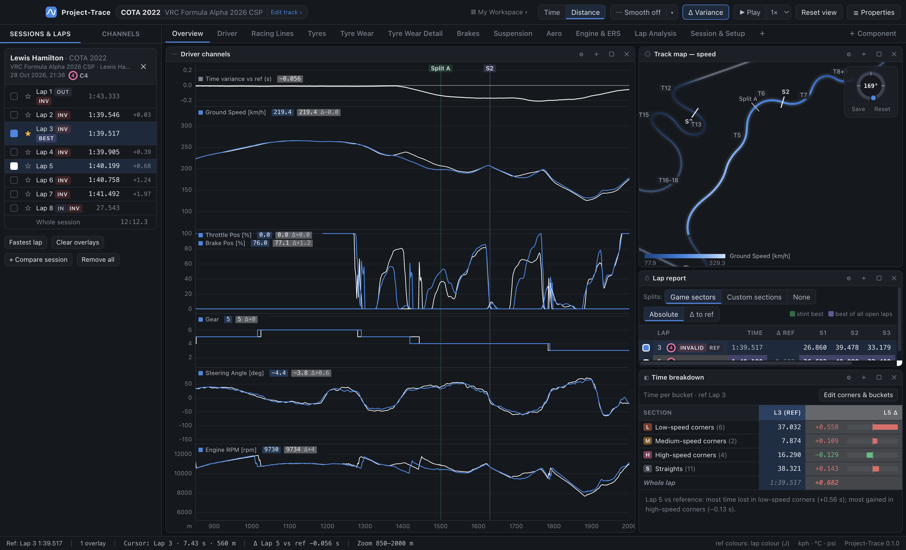
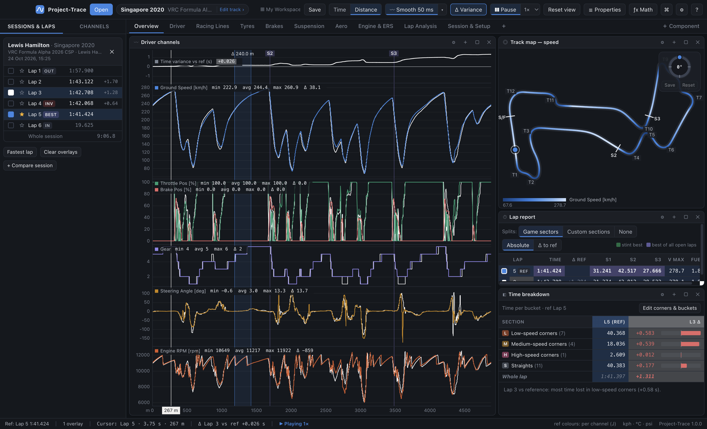
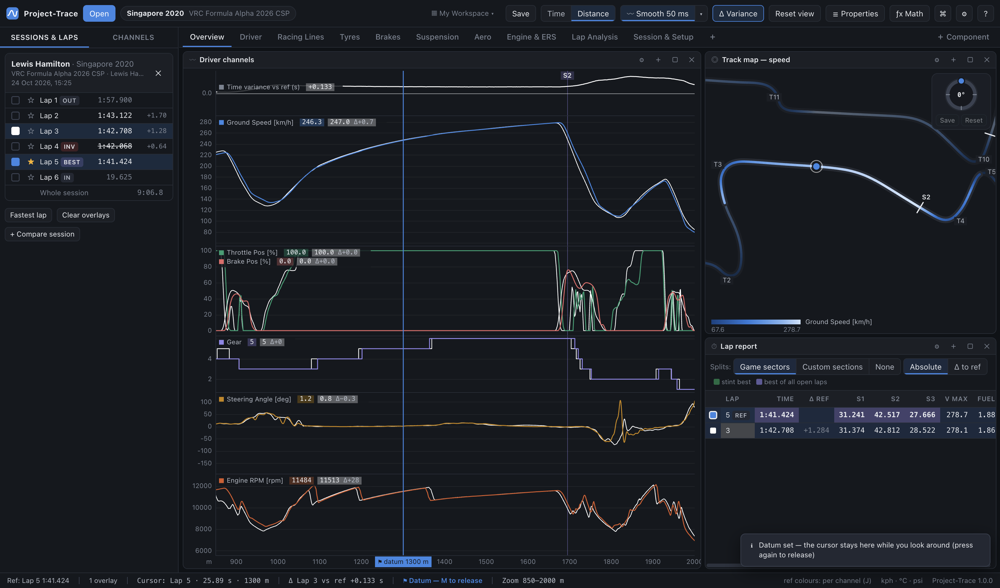
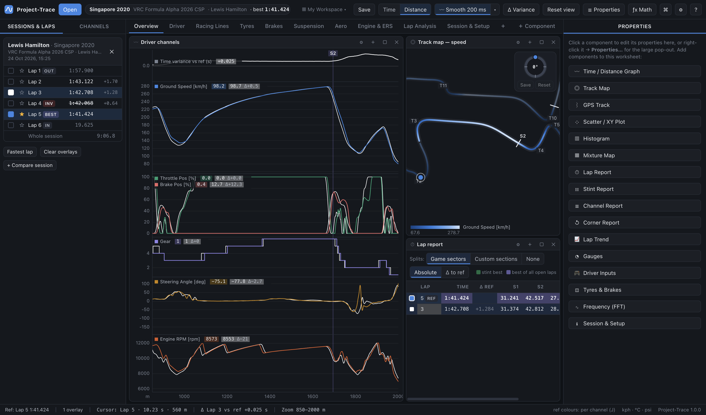
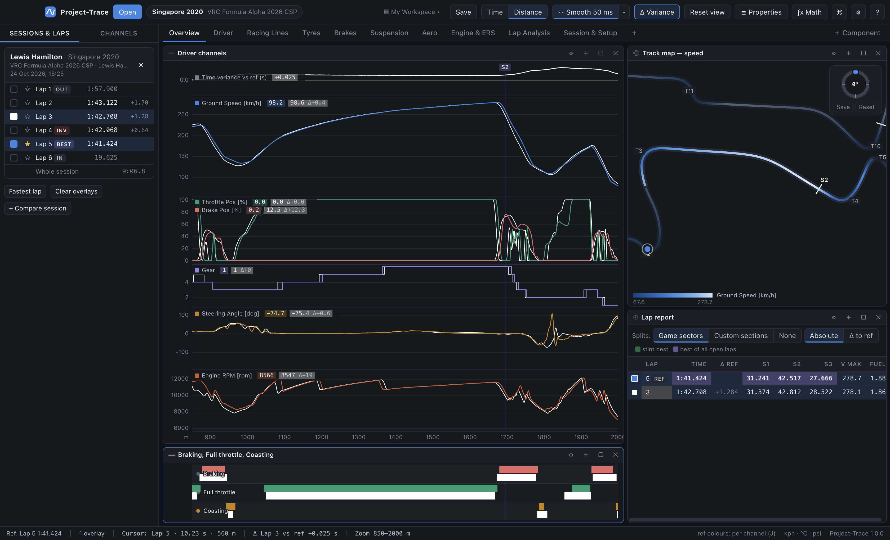
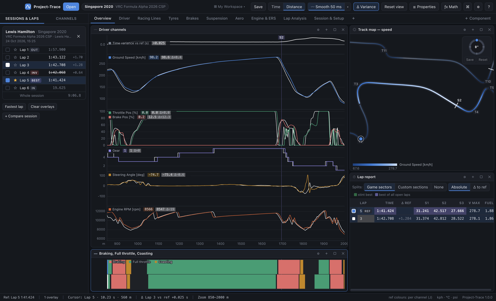

# 04 · Time / distance graph

The graph is the core of Project-Trace, equivalent to MoTeC's Time/Distance Graph.

## Panes and scales

A graph is a stack of **panes** sharing one x-axis. Each pane holds one or more channels.

| Pane scale | Behaviour | MoTeC term |
|---|---|---|
| **Auto** (default) | Shared scale if all channels have the same unit, otherwise independent | — |
| **Shared** | One y-axis for every channel in the pane | Tiled |
| **Independent** | Each channel is scaled to fill the pane; the axis shows the first channel | Overlapped |

**Pane heights**: hover over the border between two panes (the variance pane included) until it highlights, then **drag up or down**. You can also set heights with the sliders in Properties.

The y-range of each channel is either the **whole lap** (the default; stable while zooming) or the **visible area**. Fixed ranges come from *Channel properties* or a pane's shared min/max (Properties).

## Lap colours

Like MoTeC:

- **Overlay laps** are always drawn **solid in their lap colour**, for every channel. Each lap's colour stays put while it's selected.
- The **reference lap** (★) is drawn on top, either:
  - in **per-channel colours** (speed blue, throttle green, brake red…), the default; or
  - entirely in **its lap colour**.

  Press **J** (or **Analysis → Reference Lap in Channel Colours**, or Settings) to toggle. The status bar shows the current mode.
- **Change any lap's colour**: right-click its coloured square in the sidebar (or right-click the lap → *Lap colour…*). Clicking the square of a selected lap removes it. The first comparison lap is white by default. The picker offers palette swatches, a full custom colour picker and a hex field.
- **Channel colours** (used by the reference lap) are set in *Channel properties*.

## Legends: values and deltas

Each pane's legend lists its channels with their value at the cursor for every lap. Each lap's value sits on a **translucent background in that lap's colour** (blue reference, white first comparison…). For overlay laps it also shows the **Δ to the reference lap**, e.g. `Ground Speed [km/h]  236.1   237.0 Δ+0.9`. While measuring a range (Shift-drag) the legend shows **min / avg / max / Δ** over the range instead.

## X axis: time or distance

Press **D** or use the **Time | Distance** toggle.

- **Distance**: metres from the start/finish line using the game's lap distance, so laps line up corner for corner.
- **Time**: seconds since the start of each lap (session time for *Whole session*).

Switching keeps your zoom and cursor on the same piece of track.

## Cursor, zoom, pan, measure

Choose how the mouse behaves in **Settings → Cursor**:

| Mode | Click | Drag | Double-click |
|---|---|---|---|
| **Click to place, drag to zoom** (classic MoTeC, default) | places the cursor | zooms to the dragged range | resets the zoom |
| **Drag to scrub, double-click-drag to zoom** | places the cursor | **moves the cursor** through the data | then drag = **zoom** to that range |
| **Follows mouse** | — (the cursor tracks the pointer) | zooms to the dragged range | resets the zoom |

Everything else is the same in every mode:

| Action | Mouse | Keyboard |
|---|---|---|
| Move the cursor | see the mode table | ← / → (Shift = bigger steps) |
| Zoom to a range | see the mode table | + / − around the cursor |
| Zoom at the mouse | scroll wheel | |
| Pan | right-drag, middle-drag, Ctrl/⌘ + drag, Shift + wheel, trackpad swipe | |
| **Pin the cursor (datum)** | right-click → *Set datum at cursor* | **M** (toggle) |
| Reset view | **Reset view** button (hover it to see its current key) | Esc, W or Home |
| **Measure range** | **Shift + drag** | Esc clears |

- The **cursor** is shared by every component: legends, the track-map and GPS-track dots, gauges, inputs, tyres and the Channels list all follow it.
- **Zoom** is shared by every graph. Scatter, histogram, mixture, FFT and channel reports can follow it, and the Track Map and GPS Track frame the zoomed section.
- **Esc**, **W** and **Home** all reset the view to the whole lap and clear any measurement.

### Lap playback

Press **▶ Play** in the top bar (or **Space**) to play the reference lap: the cursor runs through it in **real time**, and every graph, track map, GPS track, gauge, driver-input panel and tyre panel moves with it. Pick the speed next to the button — **0.25× / 0.5× / 1× / 2× / 4×**. It starts from the cursor (or the lap start), keeps a zoomed graph scrolling along with the cursor, and stops at the end of the lap. **While it plays, the lap is locked**: clicking, dragging, scrolling or the arrow keys on graphs and maps don't move the cursor or change the zoom (a short note reminds you) — **pause** (button or Space) to look around, then play again from there. The status bar shows **▶ Playing 1×**. *Playback faster / slower* can be given keys in the shortcut editor.

### Datum: pinning the cursor

Press **M** (or right-click a graph or track map → **Set datum at cursor**) to **pin the cursor where it is**. While the datum is set, moving the mouse, clicking and the arrow keys don't move the cursor — so you can move around, switch worksheets and read every gauge, legend, tyre panel, map dot and channel value at that exact point. The cursor is drawn in the accent colour with a **⚑ datum** label and the status bar shows **⚑ Datum**. Press **M** again (or *Release datum*) to let the cursor follow you again. The key can be changed in the shortcut editor.

## Smoothing

Traces show the **raw logged samples** by default. The **〰 Smoothing** control in the top bar (next to Time/Distance) applies a centred moving average:
- click it, or press **S**, to toggle on/off;
- click **▾** to choose the amount (30 ms – 1 s, slider or presets).

Smoothing affects only graph traces and their legend values. Discrete channels (gear, flags) are never smoothed, and reports, statistics, histograms and math channels always use raw data.

## Time variance (F3)

The variance pane shows **overlay lap time − reference lap time** along the lap, so rising means the overlay is losing time. The **zero line** (level with the reference) is drawn clearly, so you can see at a glance which side of the reference each lap is. Toggle per graph (Properties) or for the whole sheet (**Δ Variance** in the top bar, **F3**, **V**). The **Δ Variance** button is highlighted while variance is shown on this worksheet. It needs two or more laps.

## Markers, corners and sections

- **Sector lines** (S2, S3…, purple) and your **splits** (green): *Sector & section lines*.
- **Corner lines** (orange) show the corners you've defined for the track: *Corner lines*.
- Lines are coloured at low opacity; their labels sit along the **top** of the graph (in the variance pane when it's shown). There are no other vertical grid lines.
- Turning lines on or off — right-click, Properties, or the shortcuts **C** (corners) and **Shift + S** (sectors & splits) — applies to **every graph** in the workspace (the shortcuts also switch the track maps and GPS tracks).
- **Right-click the graph → Add corner at cursor… / Add split at cursor…** to define them right where the cursor is. They're saved to the track profile (see [05](05-track-map.md#the-track-editor-corners-ranges-speed-buckets-splits)).

The graph's right-click menu is deliberately short: the two line toggles, *Add corner* / *Add split*, then **Properties…**, **Maximise** and **Remove component**. Everything else (variance, y-range, pane scales, legends, grid, line widths) is in Properties.

## Adding and editing channels

- Drag from the **Channels** sidebar onto a pane (near the bottom edge, or hold Shift, for a new pane).
- **Show / hide a channel without removing it**: click its **name in the legend**. A hidden channel isn't drawn and doesn't affect the pane's y-scale; its legend row stays, dimmed with a hollow swatch and *— hidden*, so you can click it back on. The same toggle is the **◉ / ◌** button (and *Hide in graph* on right-click) in the graph's Properties channel table.
- **Properties** gives the full pane-and-channel table (see [03](03-workspaces-and-layout.md#the-properties-pop-out)). Reorder panes there by **dragging a pane card by its ⋮⋮ Pane n title** onto another pane, or with the ↑ / ↓ buttons.

## Bars

**Bars** is a companion to the graph: the same x-axis, zoom, cursor and sector / corner lines, but each row is a **filled bar wherever a condition is true** instead of a trace. Use it for on/off channels (flags, DRS, ABS active, math channels like *Coasting* or *Full Throttle*) or to ask a question of any channel, e.g. *Brake Pos > 5*, *Gear = 2*, *Steering Angle between −5 and 5*.

- **Add it under a graph**: **＋** on the graph's header → *Bars* (or **＋ Component**), then drag its header to the graph's **bottom edge**. With the same width it lines up exactly, so the bars read as part of the graph. Make it short by dragging the divider; it snaps in line with other dividers.
- **Rows** (Properties): pick a **channel** and a **condition** — *is on (non-zero)*, *equals*, *is not*, *greater than*, *at least*, *less than*, *at most*, *between* — and the value(s), in the channel's display units. Give it a label and a colour, and reorder rows with ↑ / ↓.
- **Drag a channel** from the sidebar onto the bars to add a row that's on wherever the channel isn't 0.
- **Laps**: each selected lap gets its own thin lane in the row (the reference in the row's colour, comparisons in their lap colours), or show the reference only.
- The label shows **●** in the row's colour when the condition is true at the cursor.
- **Combine rows into one** (right-click the bars, or Properties): every condition is drawn in a **single row**, one lane per lap. Where several are true at the same moment, the one **highest in the Properties list wins** — reorder rows with ↑ / ↓ to set the priority (the list is numbered while combined). Each row keeps its own colour; with several laps, a short tick in each lap's colour marks its lane. The labels become one key line, with **●** on the condition winning at the cursor.

- Mouse and keys work as on the graph: click for the cursor, drag to zoom, Shift + drag to measure, scroll to zoom, double-click to reset. X-axis labels are off by default so it sits seamlessly under the graph; switch them on in Properties if it stands alone.

## Exporting

**Ctrl/⌘ + E** exports the visible range of the reference lap for every graph channel on the worksheet to CSV.
