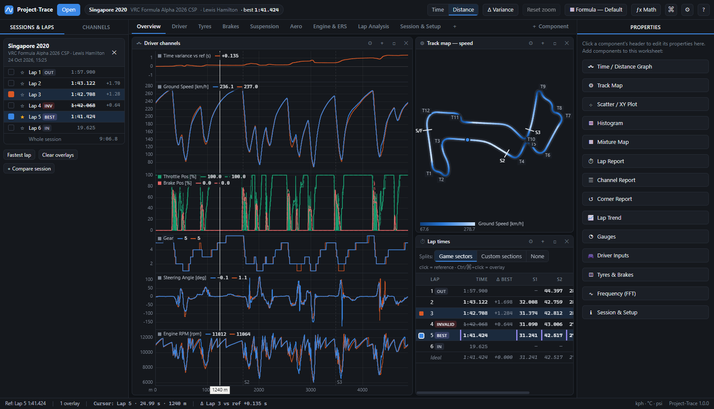
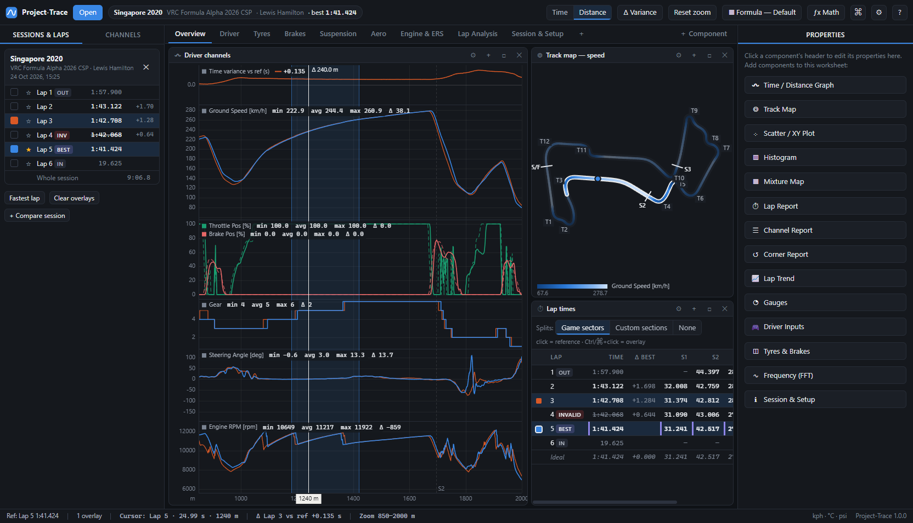

# 04 · Time / distance graph

The graph is the core of Project-Trace, equivalent to MoTeC's Time/Distance Graph.

## Panes and scales

A graph is a stack of **panes** sharing one x-axis. Each pane holds one or more channels.

| Pane scale | Behaviour | MoTeC term |
|---|---|---|
| **Auto** (default) | Shared scale if all channels have the same unit, otherwise independent | — |
| **Shared** | One y-axis for every channel in the pane | Tiled |
| **Independent** | Each channel is scaled to fill the pane; the axis shows the first channel | Overlapped |

The y-range of each channel is either the **whole lap** (stable while you zoom — the default) or the **visible area** (rescales as you zoom). Choose it from the right-click menu or the Properties panel. Fixed ranges come from *Channel properties* or a pane's min/max fields.

Edit panes in the **Properties** panel:
- add/remove channels (chips);
- choose the scale mode;
- move panes up/down;
- set relative **height**;
- set fixed min/max for shared panes.

You can also **drag the border between two panes** to resize them.

## Laps on the graph

Every selected lap is drawn. The **reference lap** (★ in the sidebar) is drawn last, on top, with a heavier line.

Overlay colouring (Settings → *Overlay colouring*):

| Mode | Single-channel panes | Multi-channel panes |
|---|---|---|
| **Auto** (default) | lap colours | channel colours; overlay laps dashed |
| **By lap** | lap colours | lap colours |
| **By channel** | channel colours, overlays dashed | channel colours, overlays dashed |

Lap colours come from a palette validated for colour-vision deficiency. Each lap keeps its colour while it stays selected, even if you add or remove others. Beyond three laps, dash patterns are added as a second cue.

## X axis: time or distance

Press **D** or use the **Time | Distance** toggle.

- **Distance**: metres from the start/finish line using the game's lap distance, so laps line up corner-for-corner. Best for comparing laps.
- **Time**: seconds since the start of each lap. For *Whole session* it is session time.

Switching keeps your zoom and cursor on the same piece of track (converted through the reference lap).

## Time variance (F3)

The variance pane shows **overlay lap time − reference lap time** at every point on track, so a rising line means the overlay is losing time there and a falling one means it's gaining.

- Toggle per graph (right-click / Properties) or for every graph on the sheet (**Δ Variance** button, **F3** or **V**).
- Needs at least two selected laps.
- The legend shows Δ at the cursor; the status bar always shows the first overlay's Δ.
- Out-laps and partial laps are zeroed at their first common point.

## Cursor, zoom, pan, measure

| Action | Mouse | Keyboard |
|---|---|---|
| Place cursor | click | ← / → (Shift = bigger steps) |
| Zoom to a range | drag | + / − around the cursor |
| Zoom at mouse | scroll wheel | |
| Pan | right-drag, middle-drag, Ctrl/⌘ + drag, Shift + wheel, trackpad swipe | |
| Reset zoom | double-click | Esc or Home |
| **Measure range** | **Shift + drag** | Esc clears |

- The **cursor** is shared by every component. Legends show each lap's value; the track map shows a dot per lap; gauges, inputs and tyres follow it; the Channels list shows live values.
- **Zoom** is shared by every graph. Scatter plots, histograms, mixture maps, FFT and channel reports can be set to "only zoomed range", and the track map highlights the zoomed section.
- **Measure** shades the range and shows its length (Δ s or Δ m). Every channel's legend switches to **min / avg / max / Δ** for the reference lap over that range, like MoTeC's range statistics.
- Prefer the cursor to follow the mouse? **Settings → Cursor → Follows mouse**.

## Markers

- **Sector lines** (S2, S3…) at the game's sector split points, plus your **custom sections**. Toggle with *Sector & section lines*.
- **Corner markers** (T1, T2… or names you've given them). Toggle with *Corner markers*.

## Adding channels

- Drag from the **Channels** sidebar onto a pane (adds to it) or near the bottom edge (new pane). Holding **Shift** always makes a new pane.
- Double-click a channel in the sidebar to add it to the selected graph as a new pane.
- Right-click the graph → **Add channel to this pane…** / **Add channel in new pane…**.

## Legend right-click menu

Right-click a channel's name in a legend:
- **Remove from graph**
- **Move to its own pane**
- **Channel properties…**
- quick **colour** swatches / **Automatic colour**

## Exporting

**Ctrl/⌘ + E** exports the **visible range of the reference lap** for every channel on the worksheet's graphs to CSV. Columns: session time, lap time, lap distance, then each channel at its highest rate.
