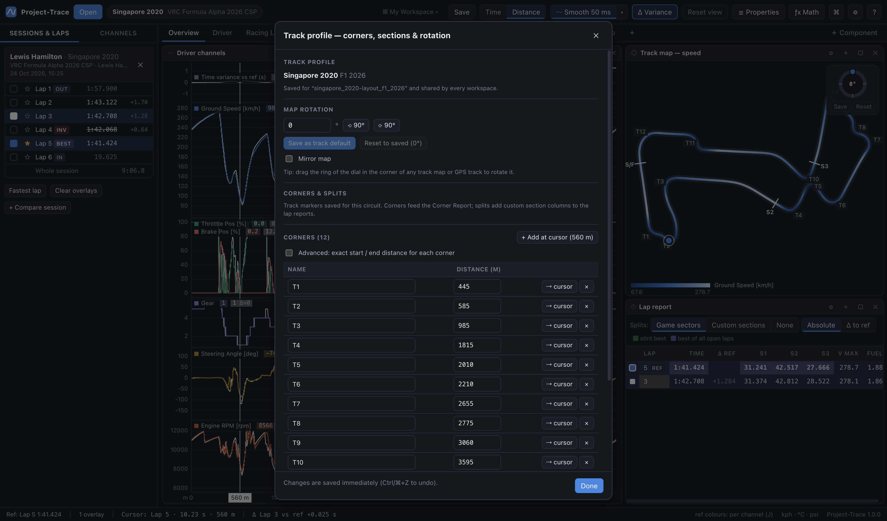

# 05 · Track Map & GPS Track

Two components draw the circuit from the car's position (`Car Coord X/Y`, or GPS latitude/longitude projected to metres):

| | **Track Map** | **GPS Track** |
|---|---|---|
| Purpose | See *what* happened where: speed, pedals, gear, elevation, time gained/lost | Compare *the lines you drove*, lap against lap |
| Line | Thick, coloured by a channel or by lap | **Thin**, one line per lap in its lap colour |
| Zoom | Highlights the graphs' zoomed range | **Frames** the graphs' zoomed range |
| Extras | Colour ramps (preset or custom), gain/loss | Line-offset readout, scale bar, follow-cursor (raw car positions only) |

Both share the **rotation dial**, the per-track **corners, sections and rotation**, cursor dots for every lap, and **click-to-seek**.

## Track Map

**Colour by** (Properties, or drag a channel onto the map):

| Mode | Shows |
|---|---|
| **Channel** (Ground Speed, Brake Pos, Gear, Car Coord Z…) | The reference lap coloured from the lap's min to max, with a legend |
| **Lap colours** | Each selected lap's line in its lap colour |
| **Time gained / lost** | Where a comparison lap gains (**green**) or loses (**red**) time against the reference. The legend shows the two laps as colour blocks: *[comparison colour] vs [reference colour] reference* |

**Colour ramps**: Blue or Orange (sequential), Blue ↔ Red (diverging), Green ↔ Red (gain/loss), or **Custom colours…**. Custom means you pick the **low** and **high** colours (or the *gaining* and *losing* colours in gain/loss mode) with the full colour picker in Properties.

**Which comparison lap** (with two or more comparison laps selected): **click the colour blocks in the legend** (*click to change lap*) and pick one — each lap is listed with its colour and lap time — right-click the map → **Compare with the reference**, or use the drop-down in Properties. Each map remembers its choice; if that lap is deselected it falls back to the first comparison lap. There's also a bindable shortcut, *Gain/loss track maps: compare the next comparison lap*, which steps every gain/loss map on the worksheet through the comparison laps.

**Gain/loss sensitivity** (Properties, in gain/loss mode):
- **Sensitivity** (×0.25 – ×4, default ×1): higher shows small gains and losses in stronger colour; lower keeps only the big differences coloured.
- **Smoothing** (4 – 200 m, default 32 m): the distance the rate of gain/loss is averaged over. More smoothing shows broad regions; less shows every small spike.

**Corner Report hover**: hovering a corner or straight in the Corner Report highlights that stretch on the track map — a white outline, with the rest of the track dimmed.

**Zoom to the graphs' selection**: select a range on a time/distance graph and the track map frames that part of the lap (the rest is dimmed, without a border). Scroll/drag to adjust; double-click to reset. Both can be switched off in Properties, together with the outline, start/finish line, car dots and legend.

## GPS Track: comparing racing lines

1. Select two or more laps (Ctrl/⌘ + click in the sidebar).
2. **Zoom the graphs into a corner**: double-click and drag across it, or click the corner in the Corner Report. The GPS Track automatically frames exactly that part of the lap for every selected lap.
3. Compare the thin lines:
   - the **scale bar** (bottom right) gives the size in metres;
   - only the raw car positions are drawn — there are no track edges;
   - the readout at the top left gives each overlay's **lateral offset from the reference line at the cursor**, e.g. *"Lap 3: 0.8 m left of ref"*.
4. Scrub the cursor along a graph to watch the cars and offsets move. With **Follow the cursor** on, a map you've zoomed into manually keeps the reference car centred.

Interactions are the same as the Track Map: scroll to zoom (much deeper on the GPS Track), drag to pan, double-click to reset, click to move the cursor. Options in Properties:
- line width;
- frame the zoomed range;
- follow cursor;
- sector/corner labels, scale bar, lap legend and the offset readout (the readout's lap values are tinted in each lap's colour).

## The rotation dial

Both maps have a small **dial** in the top-right corner:

- **Drag the ring** to rotate the map (hold **Shift** for 15° steps). Every map of the same track turns together, and the angle in Properties updates live.
- **Save** stores the current angle as **this track's default rotation**, used every time you open that track.
- **Reset** returns to the saved rotation after you've been experimenting. "unsaved" shows while they differ.

You can also type an angle, or use ⟲ 90° / ⟳ 90°, in the **Track editor**. **Mirror** is in the same place.

## The Track editor: corners, ranges, speed buckets, splits

Everything saved for a circuit is edited in one place, the **Track editor**. Open it from:
- **clicking the track name in the top bar** (it highlights on hover and shows *Edit track ›*);
- **Analysis → Track Editor…** or the command palette;
- **Edit corners & track…** when you right-click a graph or track map;
- **Edit corners & buckets** (right of the Time Breakdown's toolbar);
- the Track section of a map's or report's Properties.

Every "edit corners" link in the app leads here. On the **left** is the reference lap's map, with each corner's range drawn as a line in its speed-bucket colour (at least 15 m either side of the apex, so short corners stay visible) (L orange, M amber, H pink) and the straights in grey. On the **right** are the corner table, the detection settings and the splits.

**Corners** are **not** generated automatically: you mark each apex once per track, and it's remembered.
- **Add**: double-click the track on the editor's map; or put the cursor on the apex and use **+ Add at cursor**, or right-click a graph / map → **Add corner at cursor…**.
- **Move**: click a corner on the map to select it, then click the track where its apex should be. Or type the apex distance, or use **⇢ cursor**.
- **Rename** in the table; **×** deletes; **Clear all**; **Suggest from speed minima** proposes corners at the reference lap's slowest points (only when you click it).

**Ranges**: *Start* and *End* are detected from the reference lap's driving and shown in grey: from the lift / braking point to full throttle again, padded by the detection sliders. **Type a distance to fix one** for that corner; clear it to go back to automatic. See [08](08-laps-sectors-reports.md#corner-ranges).

**Speed bucket**: *Auto* shows the bucket from the corner's minimum speed, e.g. *Auto (Low, 86 kph)*. **Pick Low, Medium or High to override it** for that corner. The override is saved with the track and used by the Corner Report and the Time Breakdown (hover a corner's tag to see whether its bucket was set by you).

**Corner detection & speed buckets** (sliders, for every track): padding before the lift / braking point and after full throttle, the full-throttle level, and the low / high speed thresholds.

**Splits** work like corners (**+ Add at cursor**, or right-click → **Add split at cursor…**). They divide the lap into named parts for the Lap and Stint Reports' *Custom sections* columns.

Everything outside a corner counts as a straight. Corners appear on graphs (*Corner markers*), both maps (*Corner labels*) and in the **Corner Report**. Everything in the Track editor is saved per venue, shared by all workspaces, and undoable.
