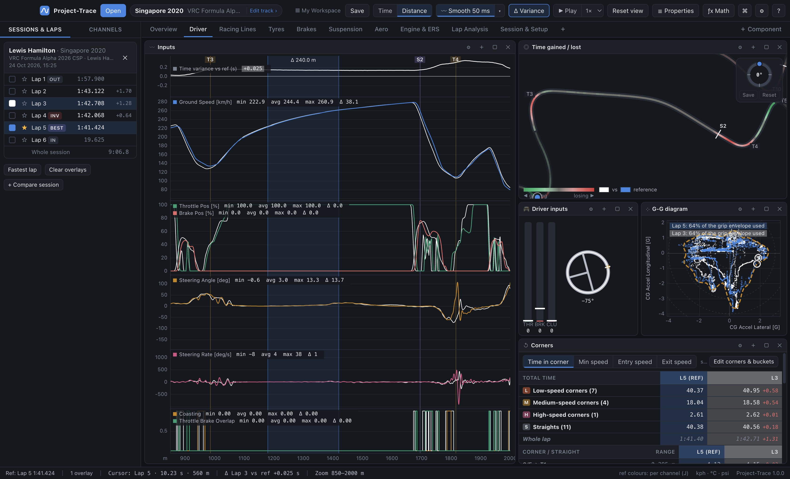
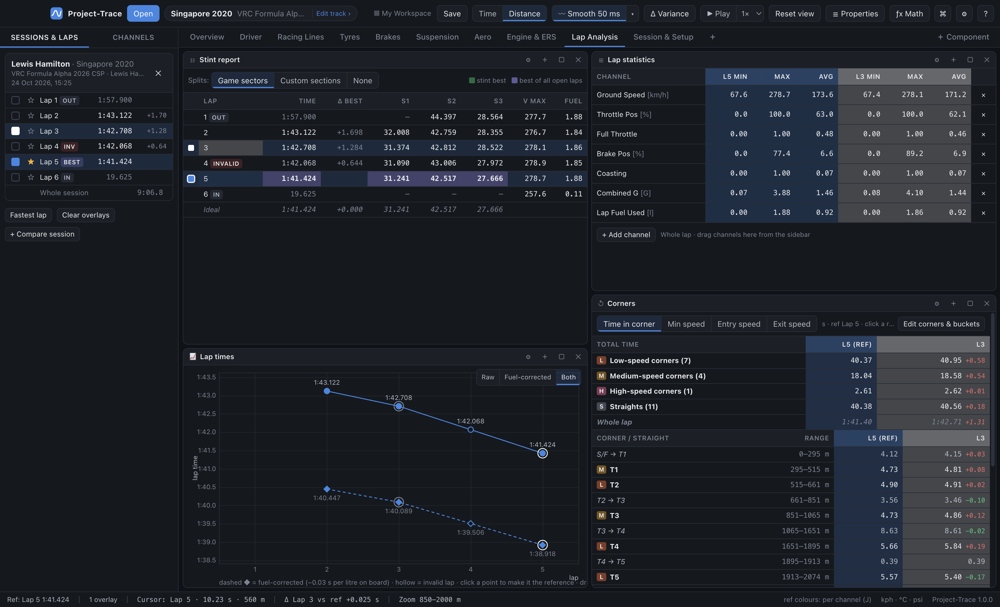
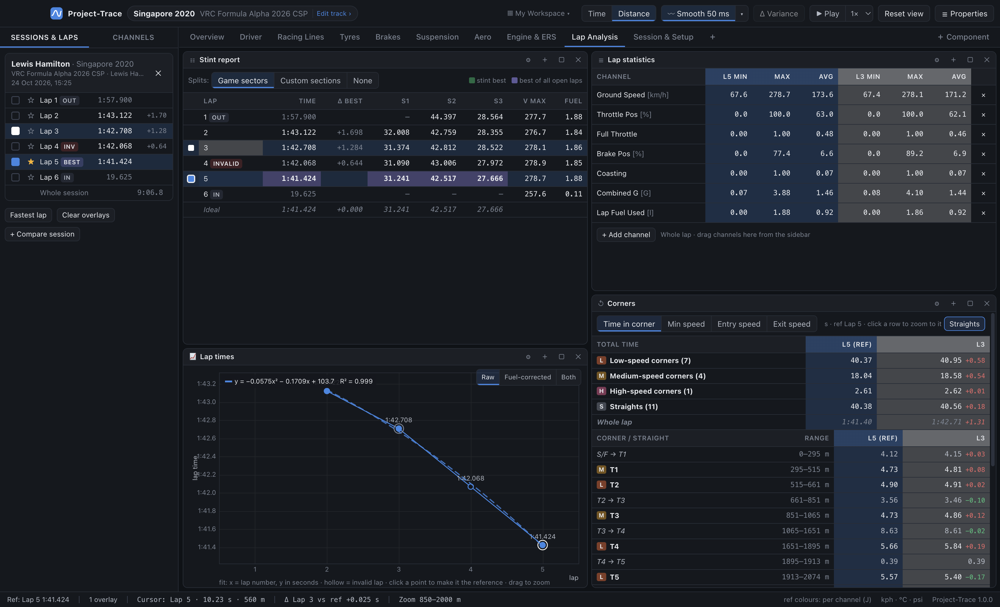

# 06 · XY charts: scatter, histogram, mixture map, FFT, lap trend

All of these use **every selected lap** (or the reference lap, for the mixture map). Most can be limited to the **zoomed range** of the graphs: zoom into one corner and the scatter shows only that corner.

**Zooming inside the chart** (scatter, lap trend, histogram, FFT):

| Input | Action |
|---|---|
| **Drag a rectangle** | zoom into that area |
| scroll | zoom around the mouse |
| right-drag / middle-drag / Ctrl+drag | pan |
| double-click | reset |

A histogram re-bins the zoomed x-range for more detail.

## Scatter / XY plot

Plots one channel against another, sample by sample. Channels at different rates are resampled to the faster one.

| Option | |
|---|---|
| **X / Y** | any channels (Properties → *Swap X and Y*) |
| **Colour** | *Lap colours* (with different marker shapes per lap) or **a third channel** on a colour ramp, with a legend |
| **Gate** | only plot samples where a channel is non-zero, e.g. gate on `Throttle Brake Overlap` or a math channel like `'Brake Pos' > 10` |
| **Best fit line** | on/off, per lap: **linear**, **polynomial** (2nd, 3rd or 4th order), **exponential**, **logarithmic** or **power**, with an optional **equation and R²** box. Toggle the line and the equation from the chart's right-click menu; choose the type in Properties. Exponential and power need positive y, logarithmic and power positive x — otherwise the box says *no fit*. |
| **X-interval averages** | MoTeC's "interval average": the mean Y in N equal bands of X, drawn as a line; sparse bands are ignored |
| **Axes & scales** | **fixed X and Y min/max** in Properties (blank = automatic; *Auto* clears them). Right-click → *Axis ranges & scales…* jumps there. |
| **Equal aspect** | same scale on both axes; with two G channels it draws **friction circles** at 1 G, 2 G… (a G-G diagram). Ignored while fixed ranges are set. |
| **Only zoomed range** | |

The cursor shows as a ring on each lap's point.

### Grip envelope (G-G)

Tick **Grip envelope** in the scatter's Properties (on by default for the Starter's *G-G diagram*). An **amber dashed line** traces the outside of the selected laps' points in every direction — in effect the car's grip limit this session for braking, cornering and accelerating, and every combination of them. For each lap, a label shows **how much of that envelope it used** on average whenever it was doing more than coasting: *"Lap 5: 64% of the grip envelope used"*. A higher figure means more of the time spent near the limit; comparing laps shows who left grip unused. The outer edge ignores the odd kerb spike, so one bump doesn't stretch it.

**Ideas:** downforce vs speed (quadratic fit → aero map); aero balance vs front ride height (interval averages); brake pressure vs longitudinal G (linear fit → braking efficiency); lateral G vs steering angle coloured by speed (understeer at speed); damper velocity front vs rear.

## Histogram

Shows the **% of time** a channel spends in each bin, with side-by-side bars per lap and a dashed mean line. Options: channel, number of bins, fixed min/max, **cumulative**, only zoomed range.

**Hover over a bar** to outline its bin and see, for every lap, the **% of time** and the **time in seconds** spent there. One-unit bins centred on whole numbers read as a single value — on the **Gear usage** histogram, *Gear 3* (or *N* / *R*) — otherwise the bin's range is shown.

**Zones** break the distribution into ranges, listed with the % time in each for every lap. The default Suspension sheet uses zones `-25, 0, 25` on damper velocity:

| Zone | Meaning |
|---|---|
| < −25 mm/s | fast rebound |
| −25 … 0 | slow rebound |
| 0 … 25 | slow bump |
| > 25 mm/s | fast bump |

This is the classic damper-tuning histogram; aim for a symmetrical, peaked shape. The cursor value is marked with a line.

## Mixture map

A 2-D histogram over the **reference lap** (or the zoomed part of it): X bins × Y bins.

- With no third channel, each cell shows the **% of time** spent there (e.g. RPM × throttle → where the engine lives).
- With a third channel (Z), each cell shows its **mean, min or max**, e.g. `Engine RPM × Throttle Pos → mean Drivetrain Power`, or `Ground Speed × Steering Angle → mean CG Accel Lateral`.

Options: bin counts, statistic, colour ramp, show cell values. The cursor position is ringed.

## Frequency (FFT)

Magnitude spectrum of a channel over each selected lap (or the zoomed range):
- linear trend removed, Hann window, radix-2 FFT;
- scaled to the ride band (≥ 0.5 Hz), with the **peak frequency** marked and listed;
- options: max frequency, log scale, only zoomed range.

Use it on damper/suspension travel or ride heights to find body and wheel-hop frequencies.

## Lap trend

One statistic per lap across the session, with each loaded session as a series:
- **Lap time** (default), or any channel's **mean / max / min / start / end / change** over the lap;
- invalid laps drawn hollow; option to show valid laps only;
- **click a point** to make that lap the reference (Ctrl/⌘ + click to overlay);
- **Y-axis range**: set a fixed min/max in Properties. Lap times are in seconds, e.g. 100–104 for 1:40–1:44. Or drag a rectangle to zoom.
- **Best fit line** (off by default): right-click the chart → *Best fit line* and *Show fit equation*, or Properties → *Best fit* to pick **linear, polynomial (2nd–4th order), exponential, logarithmic or power**. One dashed line per session (raw and fuel-corrected fitted separately), with x = lap number; the equation box shows each fit with **R²**, and a linear fit also shows the change per lap (e.g. `−0.120 s/lap` — your pace or degradation trend).
- **Raw / Fuel-corrected / Both** (top right of the chart, lap time only): fuel-corrected = lap time − *fuel effect* × the average fuel on board during the lap — each lap as if run on an empty tank, so stint pace and tyre degradation aren't hidden by the car getting lighter. *Both* draws the corrected times as a dashed line with ◆ markers. The fuel effect (default **0.03 s per litre**) is a slider in Properties. It needs a fuel level channel.

Ideas: tyre temperature build-up (`Tyre Temp Avg RR`, mean), fuel burn (`Fuel Level`, end), degradation (`Tire Rubber Grip RR`, mean), consistency (lap time).
