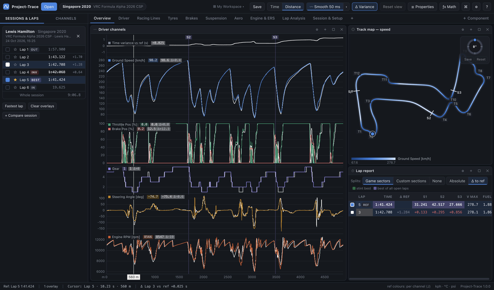

# 08 · Laps, sectors & reports

## How laps are found

Project-Trace uses the best evidence in the file, in this order:

1. **Beacons**: Telemetrick's `lapTimes` header (or MoTeC's *Beacon Markers*, or the `.ldx` markers). These are the official crossing times, so lap times match the game to the millisecond. They are used when they agree with the `Lap Number` channel.
2. **`Lap Number` changes**, refined with the lap timer (at the first sample of a new lap, `Lap Time` reads the time since crossing, which is subtracted).
3. **`Lap Distance` resets**.
4. Otherwise the whole file is one lap.

**Numbering follows MoTeC**: lap 1 is the first (partial) lap of the log. The sample file's laps are therefore 1 (out), 2, 3, 4 (invalid), **5 (best, 1:41.424)**, 6 (in).

| Tag | Meaning |
|---|---|
| **OUT** | the log started mid-lap or in the pits; this lap didn't start on the line |
| **IN** | the log ended with the car stopped (pit entry) |
| **PART** | the log ended mid-lap while moving |
| **INV** | AC's `Lap Invalidated` flag was set during the lap (track limits, cuts) |
| **BEST** | fastest complete lap in the sidebar, **even if it's invalid** (it keeps its INV tag); green = stint best, purple = best of everything open |

## Reference and overlay laps

| In the sidebar or lap report | Effect |
|---|---|
| **Click** a lap | show only this lap (it becomes the reference) |
| **Ctrl/⌘ + click** (or the checkbox) | add/remove it as an overlay |
| **Shift + click** (or ☆) | make it the **reference** (keeps the others) |
| **F** | fastest lap as reference |
| **↑ / ↓** (or PgUp / PgDn, [ / ]) | step the reference to the previous/next lap |
| *Whole session* | view the entire outing on a session-time axis |
| **Clear overlays** | keep only the reference |

**Lap colours**: each selected lap gets a colour that stays with it. **Right-click a selected lap's coloured square** (or right-click the lap → *Lap colour…*); a plain click on the square removes the lap. The reference is blue and the first comparison lap white by default. The picker offers any colour from the palette, a custom colour picker or a hex value. Overlay laps are drawn in their colour on every graph, map and report; the reference lap uses channel colours or its lap colour (toggle with **J**, see [04](04-time-distance-graph.md#lap-colours)).

The **reference** is what variance, gain/loss maps and corner deltas compare against. It is drawn on top in every chart and listed first in reports. Opening a session selects its fastest lap (even if it's invalid). Opening a *second* session adds its fastest lap as an overlay, so comparing two runs takes one action.

## Sectors

Telemetrick's `Last Sector Time` channel only updates once per second, but the values are exact. Project-Trace reconstructs each lap's sectors by finding the run of consecutive sector times that sums exactly to the lap time, then locates the **split points on track** (the median across laps). For the sample: S1 32.008 + S2 42.759 + S3 28.355 = 103.122 s, with splits at 1695 m and 3480 m.

- Laps where the game's values can't be matched (e.g. out laps) get sector times measured from the split crossings.
- A sector is only shown when the lap covers it fully.
- **Ideal lap** = sum of the best sectors from valid laps.

## Lap report and Stint report

Two components show lap and sector times:

| Component | Shows |
|---|---|
| **Lap Report** | only the **selected laps**, in **one table** — the reference first, then the comparison laps — even when they come from different sessions (each row then shows its driver and time, e.g. *Lewis Hamilton · 15:25*) |
| **Stint Report** | every lap of each **stint (session) that has a selected lap** — open a second session and it only appears once you select one of its laps. Sessions are headings inside **one table**, so the columns always line up |

| Column | |
|---|---|
| swatch / Lap | the lap's colour if selected (outlined = reference); the lap cell is tinted in the lap's colour |
| Time | lap time (grey if incomplete; invalid laps are marked by their *invalid* tag, not crossed out) |
| Δ ref / Δ best | Lap Report: gap to the reference · Stint Report: gap to the fastest lap |
| S1…Sn | sector or section times |
| V max | maximum speed (in your speed unit) |
| Fuel | fuel used during the lap |

**Best times fill the cell**: **green** = the best in that stint, **purple** = the best of every lap open at this track (with one session they are the same, so bests are purple).

**Absolute / Δ to ref** (Lap Report, next to the split buttons): show the comparison laps' sectors as times (default) or as the difference to the reference's sectors, e.g. **+0.321** (red = slower, green = faster).

The Stint Report's last row is the **Ideal** lap. Switch the split columns between **Game sectors**, **Custom sections** (from your splits, see [05](05-track-map.md)) and **None**. Columns (Δ, splits, ideal row, tags, max speed & fuel) can be switched off in Properties.

## Lap colours in side-by-side data

Wherever laps are compared side by side — the Channel Report, Corner Report, graph legends, histogram zone tables, gauges and the GPS track's offset readout — each lap's values sit on a **translucent background in that lap's colour** (blue reference, white first comparison, …), so you can tell the columns apart at a glance.

## Time breakdown

The **Time Breakdown** component is the overview of the same idea: the whole lap split into four buckets — **low-, medium- and high-speed corners** and **straights** — with, for each comparison lap, the time **gained (green, −)** or **lost (red, +)** against the reference in each, a diverging bar, and the whole-lap total. A line underneath sums it up, e.g. *"Lap 3 vs reference: most time lost in low-speed corners (+0.58 s)"*. The four buckets add up to the lap.

It uses your corners and the corner range / speed bucket settings (**Edit corners & buckets** opens the Track editor). It's on the **Overview** sheet of both default workspaces; add it anywhere with **＋ Component → Time Breakdown**. Options: gain/loss bars, and the reference lap's time per bucket.

## Channel report

A table of statistics for chosen channels for every selected lap (or only the zoomed range), each lap's columns tinted in its colour.
- Statistics: **min, max, avg, std, start, end**.
- Add channels with **+ Add channel** or by dragging from the sidebar; remove with ×.
- Values are in your display units with each channel's decimal places.

## Other stint-level components

The **Lap Trend** and **Session & Setup** components also only show stints that have a selected lap.

## Corner report

The corner report uses **the corners you define for the track**. Nothing is generated automatically; see [05](05-track-map.md#the-track-editor-corners-ranges-speed-buckets-splits). Until a track has corners, the report explains how to add them and offers two buttons: **Open the track editor**, and an optional **Suggest from speed minima** that proposes corners at the reference lap's slowest points for you to keep, rename or delete.

### Corner ranges

You only mark a corner's apex; its range comes from the **reference lap's driving**: from where you **leave full throttle** before the apex (lift or brake) to where you're **back at full throttle** after it. Ranges never reach past halfway to the neighbouring corners (or 400 m from the apex). A corner taken flat out is just the padding either side of the apex.

Adjust how it's measured with the sliders in the **Track editor** (click the **track name** in the top bar, or **Edit corners & buckets** in the Time Breakdown):

| Slider | Default | |
|---|---|---|
| **Before the lift / braking point** | 20 m | extends each corner earlier |
| **After full throttle again** | 20 m | extends each corner later |
| **Full throttle at** | 98 % | the throttle that counts as "flat" |

These apply to every track and update every report instantly. A corner given an **exact Start / End** in the Track editor keeps it. Without a throttle channel, a corner runs halfway to its neighbours (at most ±200 m). Everything that isn't inside a corner is a **straight** (named after its neighbours, e.g. *T3 → T4*; the first and last run to the start/finish line).

### Speed buckets

Every corner is classed by its **minimum speed on the reference lap** — shown as a tag next to its name:

| Tag | Bucket | Default |
|---|---|---|
| **L** | Low-speed corner | below 110 km/h |
| **M** | Medium-speed corner | 110–180 km/h |
| **H** | High-speed corner | 180 km/h and above |
| **S** | Straight | everything between corners |

Any corner can be **set to Low, Medium or High by hand** in the Track editor (*Speed* column); that's saved with the track (its tag's tooltip says it was set by you). Move the **Low speed below** and **High speed from** sliders (same place as the range sliders, in your speed unit) to fit the car. Hover a tag to see the corner's minimum speed.

| Metric | |
|---|---|
| Time in corner (first, default) | time from entry to exit |
| Min speed | lowest speed in the range |
| Entry speed | speed at the start of the range |
| Exit speed | speed at the end of the range |

At the top, **Total time** sums each lap's time in **low-, medium- and high-speed corners** and **on straights** (with how many of each), plus the **whole lap**, with the gain/loss against the reference — so you can see at once where time goes. Below, each corner and straight is listed with the chosen metric; each lap's column is tinted in its colour, and each comparison lap's delta to the reference is shown next to its value in green (better) or red (worse). The **Straights** button (top right of the report) hides or shows the straight rows (the totals still include them); totals can be hidden in Properties. **Hover a row** to highlight that corner or straight on the track map (white outline, the rest dimmed); **click a row** to zoom all graphs to it in distance mode.
