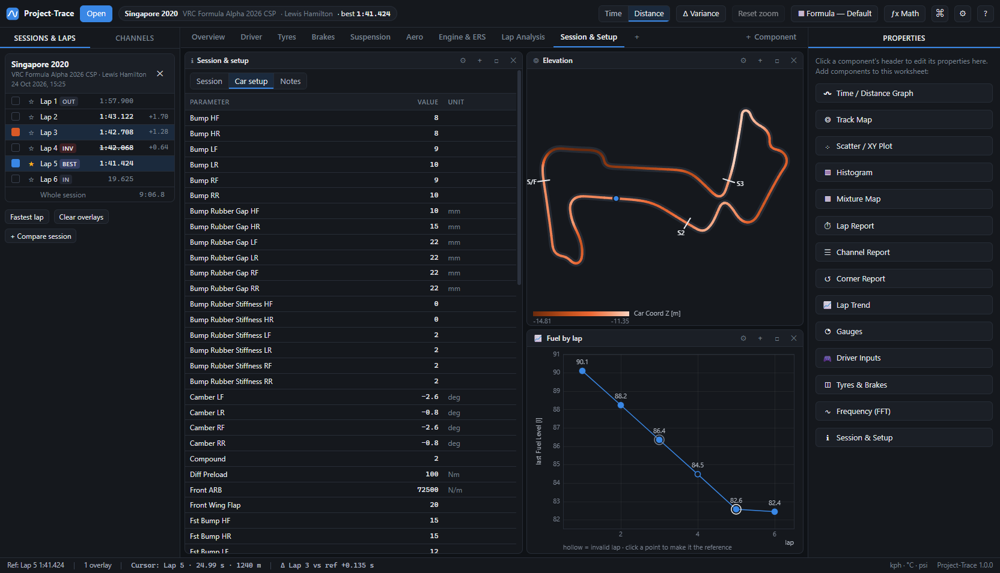

# 09 · Instruments: gauges, driver inputs, tyres & brakes, session & setup

These components display values **at the cursor**, so move the cursor (click a graph, use ← / →, or click the track map) and they follow.

## Gauges

A grid of gauges, each one of:
- **Dial**: a 270° arc with value, min/max and needle. Overlay laps appear as coloured ticks on the rim.
- **Bar**: a horizontal bar with label and value. Overlay laps appear as coloured markers.
- **Digital**: a large number. Overlay laps' values are shown above it.

Configure in the Properties panel: channel, style, min/max (blank = the channel's range) and number of columns. Or right-click a gauge to change the channel or style, remove it, or add another. **Drag a channel onto the gauges** to add a digital gauge.

## Driver inputs

Live pedal and steering view:
- **THR / BRK / CLU** bars with values. The clutch shows **pedal travel**: AC logs clutch *engagement*, which Project-Trace inverts.
- A **steering wheel** rotated by the steering angle, with the value in degrees.
- **Gear**, **speed** (your units) and an **RPM bar** that turns red near the limit.
- With *Show compare lap* on, the second selected lap appears as coloured markers on the pedal bars and a ghost wheel.

## Tyres & brakes

A top-down four-corner view:
- each tyre is split into **inner / middle / outer** surface-temperature strips, with the inner edge facing the car;
- the strips are coloured **blue (cold) → grey (≈ working range) → red (hot)**, centred on ~90 °C;
- the **core temperature** sits in the middle badge;
- a **brake disc** bar beside each tyre is coloured by disc temperature;
- text per corner: **pressure**, **brake temperature**, **tyre load**, **slip angle**.

Modes: **At cursor**, **Lap mean**, **Lap max**. Lap mean/max are great for comparing inner/outer spread when setting camber; see also the *Tyre Temp Spread* math channels.

## Session & setup

Three tabs:
- **Session**:
  - track/layout, car, livery, driver;
  - saved time, in-game time;
  - duration, laps (complete/invalid), fastest and ideal lap, track length;
  - sample rates, channel counts, format;
  - file name (*Show in folder*);
  - every **vehicle & venue detail** in the file: wheelbase, track width, gear ratios, final drive, weight, fuel capacity, weather, humidity, pressure…
- **Car setup**: the complete setup sheet Telemetrick saves with every export (springs, dampers, ARBs, bump rubbers, pressures, camber, toe, wing, diff, brake bias, ERS mode…). With **several sessions** loaded they're shown **side by side** with differences highlighted. Tick **Differences only** to see just what changed between runs.
- **Notes**: free text per session file ("+2 clicks front wing, better turn-in, rear loose on exits"), saved automatically and kept even if you move workspaces.
