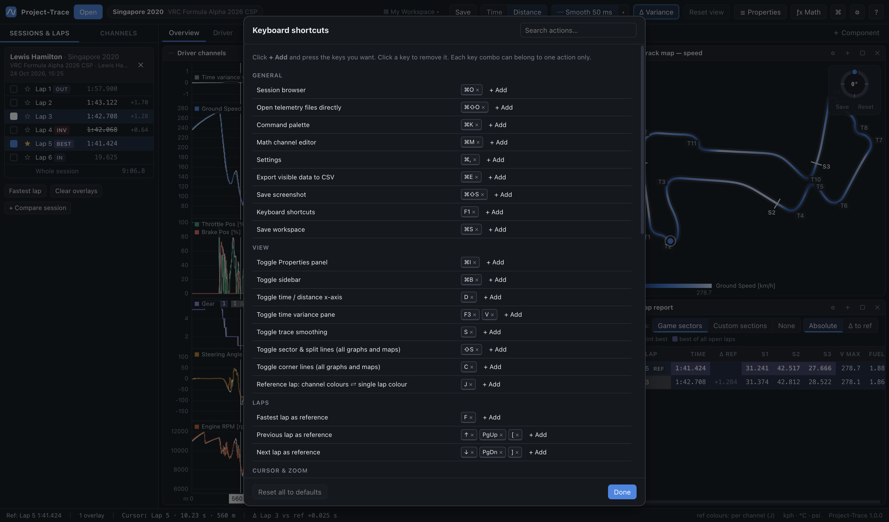

# 10 · Keyboard & mouse

Press **F1** in the app for this list. On macOS, use **⌘** wherever **Ctrl** is shown.

## Shortcut editor

Every keyboard shortcut below (except undo/redo) can be changed in **Help → Keyboard Shortcuts** (**F1**):

- **+ Add** next to an action, then press the keys you want (Esc cancels);
- click a key to remove it; an action can have several keys;
- each key combo belongs to one action — assigning it elsewhere moves it (a notice says so);
- **Reset** restores one action; **Reset all to defaults** restores everything.

Changes apply immediately, also to the hints everywhere a shortcut exists: right-click menus (e.g. the graph's *Sector & section lines* and *Corner lines*), top-bar tooltips (Variance, Reset view, Smoothing, Time/Distance…), Properties labels, the native menu bar and the command palette.

## Global

| Keys | Action |
|---|---|
| Ctrl + Z | Undo (deleted components, panes, channels, worksheets, layouts, corners…) |
| Ctrl + Y, Ctrl + Shift + Z | Redo |
| Ctrl + O | Session browser |
| Ctrl + Shift + O | Open CSV / .ld files directly |
| Ctrl + I | Toggle the **Properties side panel** (right-click a component → Properties… for the pop-out) |
| Ctrl + K | Command palette (search every action, worksheet, workspace and component) |
| Ctrl + M | Math channel editor |
| Ctrl + , | Settings |
| Ctrl + B | Toggle sidebar |
| Ctrl + C | Copy the selected (last-clicked) component, with all its settings. With text selected or in a text box it copies text as usual |
| Ctrl + V | Paste the copied component beside the selected one — on any worksheet or workspace, or into an empty worksheet |
| Ctrl + D | Duplicate the selected component |
| Ctrl + E | Export the visible data to CSV |
| Ctrl + S | Save the workspace (defaults: Save as…) |
| Ctrl + Shift + S | Save a screenshot (PNG) |
| Ctrl + P | **Print this worksheet to PDF** — exactly as on screen, one page with the worksheet, track, car and reference lap as a title |
| F1 | Keyboard & mouse help |
| 1 … 9 | Switch to worksheet 1–9 |

## Analysis

| Keys | Action |
|---|---|
| D | Toggle time / distance x-axis |
| **J** | Reference lap: per-channel colours ⇄ single lap colour |
| **S** | Toggle trace smoothing |
| **C** | Toggle corner lines on every graph, track map and GPS track |
| **Shift + S** | Toggle the game's sector lines on every graph, Bars, track map and GPS track (*Toggle split lines* does the same for your splits — no key by default) |
| F3 or V | Toggle the time-variance pane on this worksheet's graphs |
| F | Fastest lap as reference |
| **↑ / ↓** (also PgUp / PgDn, [ / ]) | Previous / next lap as reference |
| ← / → | Move the cursor (hold Shift for larger steps) |
| **0** | Cursor to the very start of the reference lap |
| + / − | Zoom in / out around the cursor |
| Esc, W, Home | Reset view: whole lap, clear the range measurement |
| **Space** | **Play / pause** the reference lap (playback) |
| **M** | **Datum**: pin the cursor at its current point / release it (see [04](04-time-distance-graph.md#datum-pinning-the-cursor)) |

## Actions without a default key

These are listed in the shortcut editor as *not set* — give any of them a key there (**+ Add**). They're also in the command palette (**Ctrl/⌘ + K**), and the right-click menus show the key once you've set one.

| Group | Actions |
|---|---|
| Track & markers | **Mark a corner at the cursor…**, **Mark a split at the cursor…**, Track editor, rotate the track maps 90°, mirror the track maps, gain/loss maps: compare the next comparison lap |
| Laps | clear comparison laps, make the first comparison lap the reference, whole session view |
| Cursor & zoom | clear range measurement, cursor to the end of the lap (start of the lap is **0**) |
| View | toggle split lines (all graphs), Properties pop-out, maximise / restore the selected component, x axis: time, x axis: distance, more / less smoothing, toggle dark / light theme, cycle cursor mode, sidebar: laps / channels |
| Worksheets | next / previous worksheet, new, duplicate, rename |
| Workspace | save as…, open the workspaces folder, import…, export… |

## Mouse: graphs

| Input | Action |
|---|---|
| Click | Place the cursor |
| Drag | **Classic mode** (default): zoom to the dragged range · **Scrub mode**: move the cursor |
| Double-click | Classic: reset zoom · Scrub: double-click then drag zooms |
| Shift + drag | Measure a range (min / avg / max / Δ) |
| Scroll | Zoom around the mouse |
| Shift + scroll, trackpad swipe | Pan |
| Right-drag, middle-drag, Ctrl + drag | Pan |
| **Drag a pane border** (highlights on hover) | Resize panes |
| **Click a channel name in the legend** | Hide / show that channel (it stays in the pane) |
| Right-click | Sector lines, split lines, corner lines (all graphs), **Set / Release datum**, **Add corner** / **Add split** at the cursor, then Properties / Maximise / Remove — each with its current key |
| Drag a channel from the sidebar | Onto a pane to add it there; onto the bottom edge (or with Shift) for a new pane |

## Mouse: other components

| Where | Input | Action |
|---|---|---|
| Scatter, lap trend, histogram, FFT | drag a rectangle | zoom into it |
| Scatter, lap trend, histogram, FFT | scroll / right-drag / double-click | zoom / pan / reset |
| Lap trend | click a point | make that lap the reference (Ctrl + click: overlay) |
| Track map, GPS track | click near the track | move the cursor there |
| Track map, GPS track | drag / scroll / double-click | pan / zoom / reset |
| Track map, GPS track | **drag the dial ring** (Shift = 15° steps) | rotate; **Save** / **Reset** under the dial |
| Corner report | hover / click a row | highlight it on the track map / zoom to the corner or straight (edit corners in Properties) |
| Histogram (e.g. Gear usage) | hover a bar | % time and seconds in that bin for each lap |
| Session browser | right-click a telemetry folder | rename, change folder, make default, remove |
| Lap lists | click / Ctrl + click / Shift + click | show only / overlay / set reference |
| Sidebar sessions | drag a session's header / right-click it | reorder sessions / move up, down, top, bottom, close |
| Sidebar laps | click a selected lap's colour square | remove that lap |
| Sidebar laps | right-click a selected lap's colour square | change its colour |
| Any component | right-click | its main options (graphs and maps: marker lines, add corner / split) + **Properties…** / Maximise / **Remove component** |
| Graph Properties | drag a pane by its ⋮⋮ title | reorder panes (↑ / ↓ also work) |
| Divider between components | drag | resize; snaps to line up with other dividers (hold Alt/⌥ for free movement) |
| Component header | drag | dock elsewhere (edges split, centre swaps) |
| Component header | double-click | maximise / restore |
| Sidebar channel | drag onto a component / double-click | add / apply it |
| Sidebar channel | right-click | **Rename…**, channel properties, add to graph, copy name |
| Worksheet tab | double-click / drag / right-click | rename / reorder / menu |
| Window | drop CSV or .ld files | open (hold Shift to add for comparison) |
