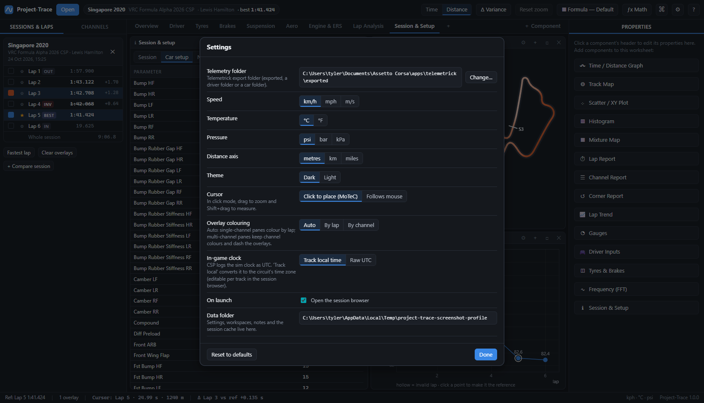
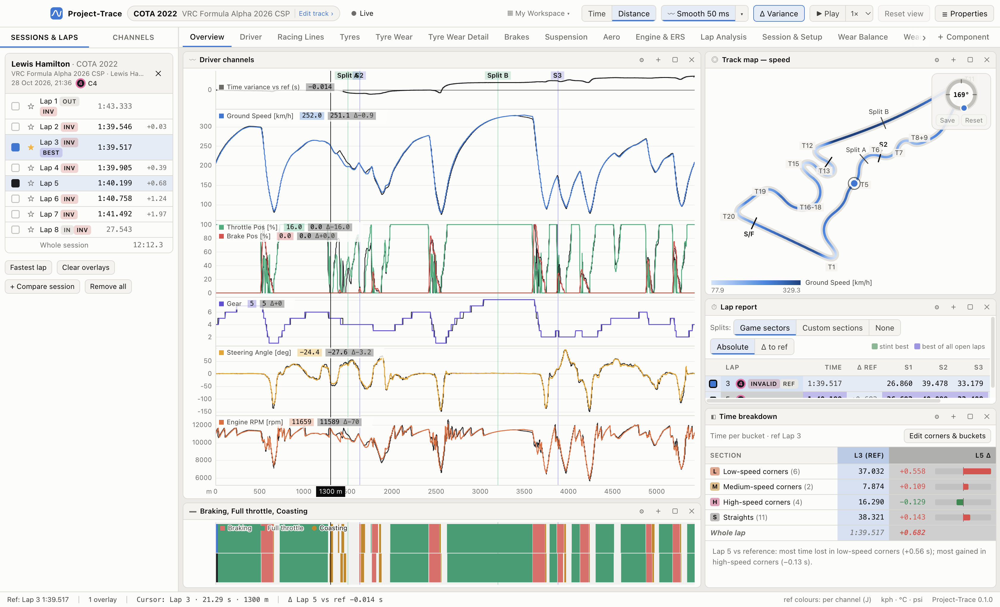

# 12 · Settings & data

Open **Settings** with **Ctrl/⌘ + ,** or **File → Settings…** (also in the command palette).

| Setting | Options | Notes |
|---|---|---|
| Telemetry folder | any folder | the root of the Session Browser |
| Speed | km/h · mph · m/s | |
| Temperature | °C · °F | |
| Pressure | psi · bar · kPa | |
| Distance axis | metres · km · miles | x-axis labels in distance mode |
| Theme | Dark · Light | first row in Settings; also **View → Theme** in the menu bar, the command palette, and an optional key in Keyboard Shortcuts. Both use colour-blind-validated palettes |
| Cursor | Click to place, drag to zoom (classic) · Drag to scrub, double-click-drag to zoom · Follows mouse | see [04](04-time-distance-graph.md#cursor-zoom-pan-measure) |
| Reference lap colours | Per channel · Single lap colour | overlay laps are always solid in their lap colour; toggle with **J** |
| Smoothing | Off (raw) · On + amount (30 ms – 1 s) | **on at 50 ms by default**; also in the top bar; **S** toggles |
| Workspaces folder | — | where your workspace files live; **Open** shows it (see [03](03-workspaces-and-layout.md#the-workspaces-folder)) |
| Tracks folder | — | one file per circuit: corners, splits, rotation; **Open** shows it (see [05](05-track-map.md#the-tracks-folder-sharing-tracks)) |
| In-game clock | Track local time · Raw UTC | see [02](02-session-browser.md#in-game-time-of-day) |
| On launch | open the session browser | |
| Session browser double-click | Add to open · Replace | switch in the browser header; also applies to drag & drop |

**Reset to defaults** restores every setting except your telemetry folder, recent files, active workspace, track profiles (corners, splits, rotation) and keyboard shortcuts. Workspaces are never touched. Shortcuts have their own reset in **Help → Keyboard Shortcuts**.

## Master channels

The second tab in Settings. Different exports can log the same data under different names. Your team-mate's car-script channels might come out as `Ext_Throttle Pedal`, `Ext_Diff Entry`, `Ext_KERS Deploy MJ`…, cut to 32 characters (`Ext_Tyre Min Starting Pressure F`), where yours are `Throttle Pedal`, `Diff Entry`, `KERS Deploy MJ`.

Each **master channel** is one name that workspaces, graph traces, reports and math channels use. It has a list of **sources**. Each session fills the master from the **first source in the list that its log has**, so one workspace works on both drivers' logs:

| Master | Sources | Your log uses | Team-mate's log uses |
|---|---|---|---|
| Throttle Pedal | Throttle Pedal, Ext_Throttle Pedal | Throttle Pedal | Ext_Throttle Pedal |
| Diff Entry | Diff Entry, Ext_Diff Entry | Diff Entry | Ext_Diff Entry |

- **Defaults:** all 50 channels that differ between the two naming styles (checked on both drivers' COTA logs of 26/10), grouped as Throttle, Brakes, Differential, ERS, Engine & PU and Other. Throttle Pos and Brake Pos are included too, so you can choose what they come from.
- **Pick a different source** by putting it first. For example, *Throttle Pos* ← `Throttle Raw, Ext_Throttle Raw` makes every throttle trace and math channel that uses Throttle Pos read the raw throttle instead. Leave a master's own name first to keep the logged channel.
- **Nothing found:** if a log has none of the sources, the channel is simply missing in that session, as before.
- **Changes apply straight away** to the open sessions: traces redraw and math channels recalculate with no reload.
- The **Open sessions use** column shows what each open session took: *as logged*, the source name, or *not logged*.
- **+ Add master channel** adds your own. **+ Add N Ext_ channels from open sessions** appears when an open log has `Ext_` channels that aren't covered yet. **Restore defaults** puts the list back.
- Master channels are a setting, not part of a workspace, so they apply to every workspace (FA26 V1.3 needs no changes: it uses the plain names).

## Where things are stored

Your **workspaces** are in a visible folder so you can find, back up and share them: `Documents/Project-Trace/Workspaces/` (see [03](03-workspaces-and-layout.md#the-workspaces-folder)). Everything else lives in Project-Trace's data folder (shown in Settings; **Help → Open Settings Folder**):

| OS | Location |
|---|---|
| Windows | `%APPDATA%\Project-Trace\` |
| macOS | `~/Library/Application Support/Project-Trace/` |

| File | Contents |
|---|---|
| `settings.json` | settings, recent files, track sort, keyboard shortcuts and in-game time zones (track profiles are in **Documents/Project-Trace/Tracks**; see [05](05-track-map.md#the-tracks-folder-sharing-tracks)) |
| `workspaces/` | only in older versions: workspaces are copied to the Documents folder once and the originals left here as a backup |
| `worksheet-library.json` | worksheets you saved with *Worksheet → Save Worksheet to Library…* |
| `session-notes.json` | your notes, keyed by session file name |
| `session-cache.json` | cached facts about opened sessions (best valid lap, ideal lap) for the browser |

Files are written atomically (temp file + rename), so a crash can't corrupt them. Back them up or copy them to another machine (Windows ↔ macOS works). To start completely fresh, quit Project-Trace and delete the folder.

## Privacy

Project-Trace is fully offline. It never uploads data and has no telemetry of its own. It only reads the folders and files you point it at.
